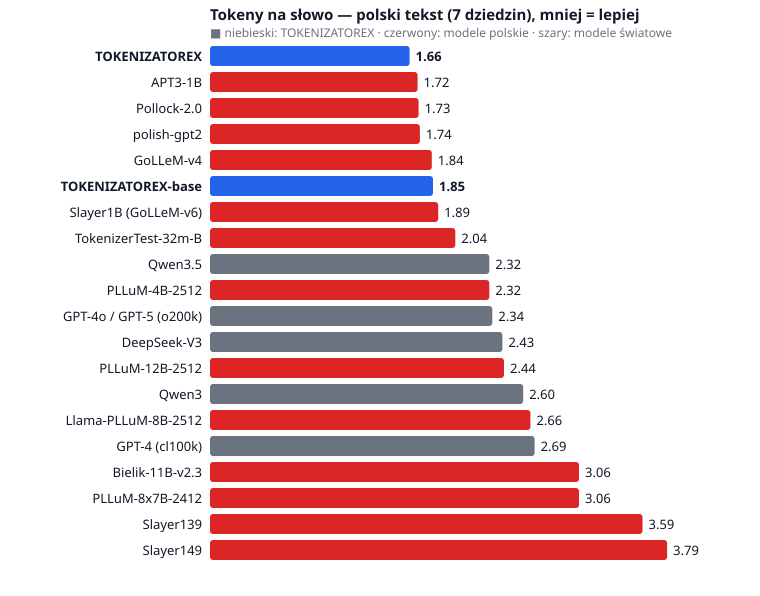

# TOKENIZATOREX

**Polski tokenizer z tokenami-frazami (SuperBPE), napisany od zera w czystym Pythonie.**

TOKENIZATOREX to byte-level BPE z drugim etapem treningu, opartym na pracy **SuperBPE**
(Liu i in., 2025, *„SuperBPE: Space Travel for Language Models”*). W tym etapie merge'e mogą
**przekraczać spację**, więc słownik uczy się całych polskich zwrotów: `" na podstawie"`,
`" w ramach"`, `", że"`, `" w związku z"`, `" nie tylko"`. Trenowany na
[`SlayerLab/hplt-v3-pl-cleaned`](https://huggingface.co/datasets/SlayerLab/hplt-v3-pl-cleaned).
Powstał jako praca domowa na kursie [Fabryka AI](https://fabryka.ai/).

```
Wydaje mi się, że nie tylko w Polsce jest to możliwe.
  GPT-4 (cl100k)       17 tok  W|yd|aje|·mi|·się|,|·że|·nie|·tylko|·w|·Pols|ce|·jest|·to|·możli|we|.
  TOKENIZATOREX-base   13 tok  Wydaje|·mi|·się|,|·że|·nie|·tylko|·w|·Polsce|·jest|·to|·możliwe|.
  TOKENIZATOREX         7 tok  Wyda|je|·mi·się,·że|·nie·tylko|·w·Polsce|·jest·to|·możliwe.
```

## Wynik w skrócie

- Na polskim tekście z **7 dziedzin** TOKENIZATOREX jest **1. z 20** porównywanych tokenizerów
  i potrzebuje najmniej tokenów na słowo (1,656).
- W porównaniu z modelami polskimi: **o 14% mniej tokenów niż Slayer1B**, o 47% mniej niż
  PLLuM-12B i o 85% mniej niż Bielik v2.3.
- W porównaniu z modelami światowymi: o 41% mniej tokenów niż GPT-4o/GPT-5 i o 63% mniej niż GPT-4.
- Przy **tym samym słowniku 32k** sam etap SuperBPE daje **10,7% mniej tokenów** niż zwykły BPE.
- Cena za to: **angielski** jest około 1,7× droższy niż w modelach światowych, a w tekstach naukowych
  wygrywa APT3. To tokenizer pod polski.



## Benchmark: TOKENIZATOREX vs tokenizery prawdziwych modeli

Każdy tokenizer koduje te same teksty, po około 2 MB na dziedzinę. **Fertility** to liczba tokenów
na słowo (słowo = `str.split()`): mniej oznacza tańsze wywołania, szybsze generowanie i więcej
tekstu w oknie kontekstu modelu.

| # | tokenizer | słownik | web | wikipedia | literatura | prawo | sejm | nauka | dyskusje | angielski | **PL średnio** | tokenów PL vs TOKENIZATOREX |
|---:|---|---:|---:|---:|---:|---:|---:|---:|---:|---:|---:|---:|
| 1 | **TOKENIZATOREX** | 32 000 | **1,43** | 1,79 | **1,65** | **1,57** | **1,30** | 2,27 | **1,65** | 1,97 | **1,656** | — |
| 2 | APT3-1B ¹ | 31 980 | 1,60 | 1,83 | 1,73 | 1,58 | 1,43 | **2,18** | 1,75 | 1,82 | 1,722 | +4% |
| 3 | Pollock-2.0 (SlayerLab) | 49 152 | 1,61 | **1,78** | 1,80 | 1,64 | 1,40 | 2,22 | 1,72 | 1,77 | 1,731 | +5% |
| 4 | polish-gpt2 | 51 200 | 1,56 | 1,81 | 1,66 | 1,75 | 1,42 | 2,33 | 1,72 | 1,86 | 1,741 | +5% |
| 5 | GoLLeM-v4 (SlayerLab) | 32 000 | 1,73 | 1,94 | 1,73 | 1,73 | 1,52 | 2,42 | 1,87 | 2,04 | 1,840 | +11% |
| 6 | **TOKENIZATOREX-base** | 32 000 | 1,61 | 1,96 | 1,78 | 1,88 | 1,52 | 2,40 | 1,86 | 1,98 | 1,850 | +12% |
| 7 | **Slayer1B** (GoLLeM-v6) | 32 768 | 1,71 | 1,99 | 1,92 | 1,84 | 1,60 | 2,33 | 1,90 | 1,30 | 1,894 | +14% |
| 8 | TokenizerTest-32m-B (SlayerLab) | 32 000 | 1,85 | 2,05 | 1,96 | 2,09 | 1,73 | 2,48 | 2,13 | 2,10 | 2,035 | +23% |
| 9 | Qwen3.5 | 248 070 | 2,15 | 2,42 | 2,25 | 2,47 | 2,05 | 2,58 | 2,32 | 1,23 | 2,317 | +40% |
| 10 | **PLLuM-4B-2512** (≈ Gemma 3) | 262 147 | 2,13 | 2,38 | 2,22 | 2,51 | 2,05 | 2,69 | 2,27 | 1,19 | 2,317 | +40% |
| 11 | GPT-4o / GPT-5 (o200k) | 200 019 | 2,24 | 2,45 | 2,29 | 2,40 | 2,17 | 2,55 | 2,32 | 1,18 | 2,342 | +41% |
| 12 | DeepSeek-V3 | 128 815 | 2,34 | 2,49 | 2,38 | 2,45 | 2,28 | 2,66 | 2,40 | 1,18 | 2,425 | +46% |
| 13 | **PLLuM-12B-2512** (≈ Mistral Nemo) | 131 072 | 2,29 | 2,43 | 2,34 | 2,53 | 2,26 | 2,84 | 2,42 | 1,22 | 2,439 | +47% |
| 14 | Qwen3 | 151 669 | 2,48 | 2,72 | 2,46 | 2,71 | 2,39 | 2,87 | 2,58 | 1,23 | 2,598 | +57% |
| 15 | **Llama-PLLuM-8B-2512** (≈ Llama 3) | 128 259 | 2,58 | 2,76 | 2,58 | 2,71 | 2,54 | 2,86 | 2,61 | 1,19 | 2,658 | +61% |
| 16 | GPT-4 (cl100k) | 100 277 | 2,61 | 2,79 | 2,60 | 2,74 | 2,56 | 2,93 | 2,64 | 1,19 | 2,693 | +63% |
| 17 | **Bielik-11B-v2.3** (≈ Mistral 7B) | 32 128 | 2,93 | 3,13 | 2,93 | 3,18 | 2,90 | 3,39 | 3,00 | 1,34 | 3,061 | +85% |
| 18 | PLLuM-8x7B-2412 (≈ Mixtral) | 32 003 | 2,93 | 3,13 | 2,93 | 3,18 | 2,90 | 3,39 | 3,00 | 1,34 | 3,061 | +85% |
| 19 | Slayer139 | 24 576 | 3,53 | 3,64 | 3,52 | 3,59 | 3,54 | 3,86 | 3,46 | 1,25 | 3,588 | +117% |
| 20 | Slayer149 | 12 288 | 3,75 | 3,88 | 3,71 | 3,78 | 3,73 | 4,07 | 3,65 | 1,38 | 3,793 | +129% |

¹ **APT3 nie jest bezstratny.** Normalizuje NFKC, usuwa tabulatory i polskie cudzysłowy `„”`, zamienia `½` na
`12`. Część jego przewagi bierze się więc z wyrzucania znaków. Qwen3/3.5 i TokenizerTest-B normalizują NFC
(nieszkodliwe), a reszta, w tym TOKENIZATOREX, odtwarza tekst bajt w bajt. Pełne dane:
[`results/benchmark.json`](results/benchmark.json), [`results/benchmark.md`](results/benchmark.md).

**Skąd tokenizery.** Każdy pochodzi z `tokenizer.json` danego modelu na Hugging Face. Tokenizer Slayer1B
(1.00–1.09) potwierdziłem sumą SHA-256 podaną w karcie modelu (`0640d3bd…`), bo to ten sam plik co w GoLLeM-v6.
Modele PLLuM korzystają z tokenizerów rodzin bazowych (Gemma 3, Mistral Nemo, Llama 3, Mixtral), więc tabela
pokazuje też, jak tną polski te rodziny.

**Nie ma w tabeli** modeli „gated” (wymagają akceptacji licencji i logowania): Bielik v3 (tokenizer APT4),
oryginalna Llama 3, Gemma 3, EuroLLM. Po `hf auth login` wystarczy:
`python benchmark.py --extra speakleash/Bielik-11B-v3.1-Instruct utter-project/EuroLLM-9B`.

**Dziedziny.** `web` to held-out z HPLT, czyli inny shard niż trening. `wikipedia`, `literatura` (Wolne Lektury),
`prawo` (Dziennik Ustaw), `sejm` (stenogramy komisji), `nauka` (Biblioteka Nauki) i `dyskusje` (strony dyskusji
Wikipedii) pochodzą z [`SlayerLab/polish-dynaword`](https://huggingface.co/datasets/SlayerLab/polish-dynaword).
`angielski` to wikitext-103 (test). Uwaga: trening był tylko na tekstach z sieci, więc pozostałe dziedziny
są dla TOKENIZATOREX tekstem spoza domeny.

## Jak działa

**Pretokenizacja jest dwupoziomowa:**

1. *Fragmenty* (`CHUNK_PATTERN`): cięcie na nowych liniach i interpunkcji kończącej zdanie `. ! ? ; : …`.
   Tej granicy nie przekracza żaden token.
2. *Słowa* (`WORD_PATTERN`): regex w stylu cl100k/o200k, uproszczony dla polskiego (cyfry po maksymalnie 3).

**Etap 1** to zwykły byte-level BPE wewnątrz słów, do rozmiaru *t* = 20 000. **Etap 2** to BPE na całych
fragmentach (przez spacje), do 32 000, z ograniczeniami: maksymalnie **4 słowa** w tokenie, bez dublowania
par z etapu 1. **Kodowanie:** merge'e etapu 1 wg rangi wewnątrz słów, potem etapu 2 wg rangi w całym
fragmencie. Odtwarza to dokładnie stan korpusu po treningu (test parytetu). Token specjalny `<|endoftext|>`
(id 31999).

**Implementacja** ([`superbpe.py`](superbpe.py)) to inkrementalny BPE: unikalne sekwencje z częstościami,
licznik par, indeks *para → sekwencje* i kopiec z leniwym usuwaniem. Wynik jest identyczny z naiwnym BPE
(test). Trening na laptopie (Ryzen 7 260, 32 GB): etap 1 trwa 143 s na 300 MB, etap 2 około 4 min na 100 MB.

## Ablacja: punkt przejścia *t* (held-out web, 10 MB)

| wariant | t | tokeny | fertility | bytes/tok | vs cl100k | superwords |
|---|---:|---:|---:|---:|---:|---:|
| GPT-4 (cl100k) | — | 3 537 688 | 2,603 | 2,83 | 1,00× | — |
| GPT-4o (o200k) | — | 3 033 590 | 2,232 | 3,30 | 1,17× | — |
| TOKENIZATOREX-base | 32k | 2 181 725 | 1,606 | 4,59 | 1,62× | — |
| superbpe-32k-t16k | 16k | 1 947 409 | 1,433 | 5,14 | 1,82× | 9,9% |
| **TOKENIZATOREX** | 20k | **1 947 130** | **1,433** | **5,14** | **1,82×** | 9,7% |
| superbpe-32k-t24k | 24k | 1 947 805 | 1,433 | 5,14 | 1,82× | 9,3% |
| superbpe-32k-t28k | 28k | 1 959 395 | 1,442 | 5,11 | 1,81× | 8,0% |

## Wnioski i zaskoczenia

- **Dane polskie biją rozmiar słownika.** Słownik 32k trenowany na polskim tnie polski lepiej niż
  słowniki 128k–262k modeli światowych.
- **Punkt przejścia prawie nie ma znaczenia przy 32k.** Dla t od 16k do 24k różnica wynosi 0,03%. Etap 2
  nie uczy się wyłącznie fraz: przy t=16k tylko 5 041 z 15 999 merge'y to superwordy. W pracy SuperBPE
  (angielski, słownik 200k) zysk wynosił około 33%, u nas 10,7%.
- **Polski ma bardzo „frazowy” rdzeń:** `, że`, `, a także`, ` się w`, ` w związku z`, ` ze względu na`,
  ` po raz pierwszy`, ` Ochotniczej Straży Pożarnej`.
- **Artefakty:** niektóre superwordy zaczynają się w środku słowa (`nku węgla`), a częste słowa potrafią
  stracić własny token (`Wyda|je`).
- **Słabsze strony:** w tekstach naukowych prowadzi APT3 (2,18 vs 2,27), w Wikipedii Pollock-2.0 (1,78 vs 1,79).
  Angielski jest około 1,7× droższy niż w GPT-4o.

## Ograniczenia (uczciwie)

- **Fertility to nie jakość modelu.** Nie trenowałem modelu. Krótsze sekwencje to pewny zysk kosztowy,
  a wpływ na jakość trzeba zmierzyć, np. trenując mały model na TOKENIZATOREX i na zwykłym BPE.
- **Porównanie z modelami nie jest „na równych zasadach”.** Modele światowe obsługują dziesiątki języków
  i kod, a TOKENIZATOREX tylko polski.
- **Eksport HF nie jest 1:1 dla SuperBPE.** Format HF ma jeden poziom pretokenizacji, więc na held-oucie
  99,20% fragmentów ma identyczną segmentację, a tokenów jest o 0,006% więcej. Round-trip jest bezstratny.
  Wariant base eksportuje się w 100% identycznie.

## Użycie

```python
from tokenizers import Tokenizer                       # format Hugging Face
tok = Tokenizer.from_file("hf/tokenizatorex-32k/tokenizer.json")
print(tok.encode("Na podstawie umowy, w ramach projektu.").tokens)

from superbpe import SuperBPETokenizer                 # referencyjny enkoder (dokładny)
tok = SuperBPETokenizer.load("tokenizers/tokenizatorex-32k.json")
ids = tok.encode("Na podstawie umowy, w ramach projektu.")
```

## Odtworzenie

```bash
pip install -r requirements.txt
# dane: shardy bin8_5_p0 i bin8_6_p0 z SlayerLab/hplt-v3-pl-cleaned -> ../data/raw/data/
python prepare_data.py                 # ../data/train.txt (300 MB), ../data/heldout.txt (10 MB)
python -m pytest -q                    # 10 testów: round-trip, parytet, naiwny == szybki, ...
python train.py baseline --vocab 32000 --out tokenizers/tokenizatorex-base-32k.json
python train.py superbpe --from tokenizers/tokenizatorex-base-32k.json --transition 20000 \
       --vocab 32000 --stage2-mb 100 --out tokenizers/tokenizatorex-32k.json
python evaluate.py "tokenizers/*.json"                 # ablacja na held-oucie
python prepare_benchmark.py                            # teksty z 8 dziedzin
python benchmark.py                                    # TOKENIZATOREX vs 18 tokenizerów modeli
python export_hf.py tokenizers/tokenizatorex-32k.json --out-dir hf --check ../data/heldout.txt
python demo.py "Twoje zdanie."
```

## Pliki

| plik | co |
|---|---|
| `superbpe.py` | rdzeń: pretokenizacja, pętla BPE, etapy 1–2, encode/decode, zapis |
| `train.py` | trening (baseline / superbpe) |
| `evaluate.py` | ablacja na held-oucie vs cl100k / o200k |
| `benchmark.py` | porównanie z tokenizerami modeli na 8 dziedzinach + wykres SVG |
| `prepare_data.py`, `prepare_benchmark.py` | przygotowanie danych |
| `export_hf.py` | eksport do `tokenizer.json` + pomiar zgodności |
| `demo.py` | porównanie segmentacji na przykładowych zdaniach |
| `test_superbpe.py` | testy poprawności |
| `tokenizers/` | TOKENIZATOREX, wariant base i warianty ablacji (format własny) |
| `hf/` | eksport Hugging Face |
| `results/` | metryki, benchmark, logi, demo |

## Źródła

- Liu i in. (2025), *SuperBPE: Space Travel for Language Models*, arXiv:2503.13423
- Karpathy, *Let's build the GPT Tokenizer* · [minbpe](https://github.com/karpathy/minbpe)
- Warsztat Slayer: [slayerlabs/tokenizer](https://github.com/slayerlabs/tokenizer)
- Dane: [SlayerLab/hplt-v3-pl-cleaned](https://huggingface.co/datasets/SlayerLab/hplt-v3-pl-cleaned),
  [SlayerLab/polish-dynaword](https://huggingface.co/datasets/SlayerLab/polish-dynaword), wikitext-103
