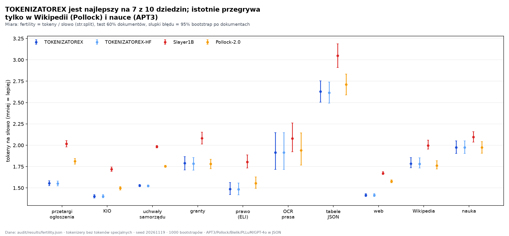
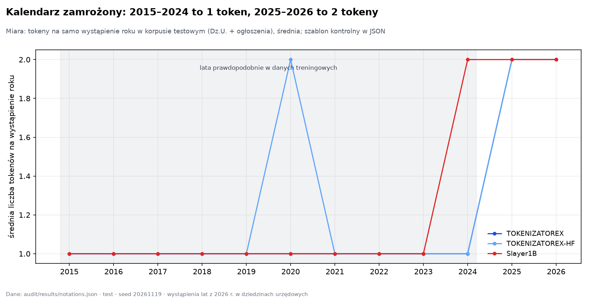
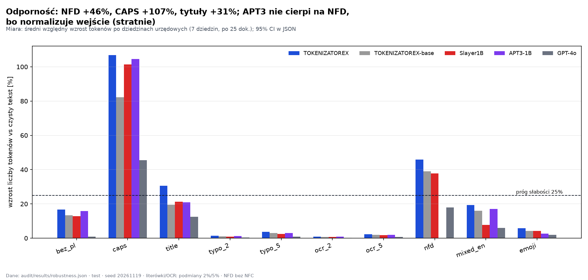
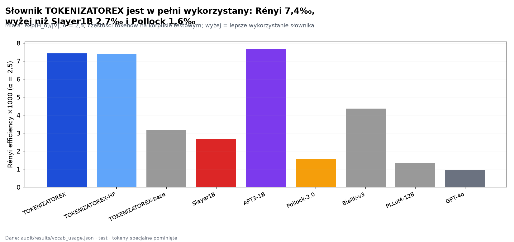

# RAPORT KOŃCOWY — mocne i słabe strony TOKENIZATOREX (TKX-A)

Data: 19.11.2026 · Repo: `adgr3/tokenizatorex` · gałąź `audyt/tkx-a-19-11`
· baza `faf06223806809a79f2df0bd64efbd4c57e2d98e`
· Protokół: `audit/PROTOKOL.md` · Korpus: `audit/data/MANIFEST.json`
· Wszystkie liczby: `audit/results/*.json` (skrypty w `audit/`).

## 1. Podsumowanie w 10 zdaniach

1. Na **7 nowych dziedzinach urzędowych 2026** (przetargi, KIO, uchwały,
   granty, prawo ELI, OCR prasy, tabele JSON) TOKENIZATOREX jest najlepszy na
   6 i praktycznie remisuje na 1; zbiorczo ma **1,6825 tokenu/słowo** wobec
   1,7921 Pollocka (−6,1%), 1,8612 APT3 (−9,6%) i 2,0265 Slayera (−17,0%).
2. Na **15 dziedzinach** (z web, Wikipedią, literaturą, nauką, dyskursami,
   angielskim) jest najlepszy na 12; istotnie przegrywa tylko w Wikipedii
   (Pollock, −1,25%) i nauce (APT3, −2,95%).
3. **Kalendarz jest zamrożony:** lata 2015–2024 kosztują 1 token, 2025–2026
   już 2; zdanie `w roku RRRR r. zadanie` ma 4 tokeny dla starych lat i 5 dla
   nowych. To najważniejsza słabość dla modelu, który będzie czytał nowe
   ogłoszenia.
4. **Zapisy urzędowe są tanie, ale niestabilne:** kwota 3,87 tokenu (Slayer
   5,23), data słowna 3,76 (5,31), przepis 4,20 (5,78), ale ten sam zapis jest
   dzielony inaczej w 12,8–57,1% kontekstów (Slayer w wielu kategoriach 0%).
5. **Odporność jest słaba:** NFD +45,9%, CAPS +106,8%, tytuły +30,6% tokenów;
   względnie więcej niż Slayer1B o 5–9 pkt proc. (NFD, CAPS, tytuły).
6. **Eksport HF nie jest 1:1:** 97,27% identycznych fragmentów na dziedzinach
   urzędowych vs 99,36% na web; różnice do −0,52% tokenów. Trening i ocena
   muszą używać tego samego enkodera.
7. **Słownik jest zdrowy:** 1,8% tokenów martwych (Slayer 8,9%, Pollock 9,4%)
   i Rényi 7,4‰ (Slayer 2,7‰, Pollock 1,6‰); to najmocniejsza przewaga
   „inżynierska”.
8. **H6 jest obalona w skali z rekonesansu:** „od środka słowa” zaczyna się
   3,5% superwordów (1,6–13,2% zależnie od definicji), a ich użycie to
   0,04–0,59% — nie 19,4%. Artefakt istnieje, ale jest rzadszy.
9. **Ranking jest odporny:** red team nie zmienił top-1 ani top-2 na 30
   kombinacjach definicji słowa, jednostki i obcięcia ogona; boilerplate nie
   jest źródłem przewagi (zmiana <0,5%). Jedyna lokalna korekta: na `granty`
   w kontekście 2048 mediana faworyzuje TKX, ale p90/średnia Pollocka.
10. **Nie mierzyliśmy jakości modelu 150M** — tylko koszt i segmentację;
    fertlity to nie jakość, a MorphScore słabo ją przewiduje (R² ≈ 0,02).

## 2. Mocne strony

| Mocna strona | Liczba [95% CI] | Plik |
|---|---|---|
| Najlepszy na 7 dziedzinach urzędowych | 1,6825 [1,6412; 1,7279] tok./słowo | `official_aggregate.json` |
| Przewaga nad Slayer1B (oficjalne) | −17,0% tokenów | `official_aggregate.json` |
| Przewaga nad Pollockiem (oficjalne) | −6,1% | `official_aggregate.json` |
| Przewaga nad APT3 (oficjalne) | −9,6% | `official_aggregate.json` |
| KIO: 1. miejsce | 1,403 [1,383; 1,420] | `fertility.json` |
| Kwoty: taniej niż Slayer | 3,87 vs 5,23 tokenu (−26%) | `notations.json` |
| Daty słowne: taniej niż Slayer | 3,76 vs 5,31 (−29%) | `notations.json` |
| Przepisy: taniej niż Slayer | 4,20 vs 5,78 (−27%) | `notations.json` |
| Słownik: mało martwych tokenów | 1,8% (Slayer 8,9%) | `vocab_usage.json` |
| Słownik: Rényi α=2,5 | 7,4‰ (Slayer 2,7‰) | `vocab_usage.json` |
| Szybkość eksportu HF | 575 tys. tok/s, 2,98 MB/s | `speed.json` |
| Stabilność wydajności przy retreningu | −0,12%…+1,96% fertility | `stability.json` |
| Red team: odporność rankingu | 0/30 zmian top-1 i top-2 | `RED_TEAM_R3.md` |
| Red team: rzadkie przegrane per dokument | Slayer wygrywa 6/606 dok. | `RED_TEAM_R3.md` |

## 3. Słabe strony

| Słabość | Skala [95% CI / zakres] | Przykład | Plik |
|---|---|---|---|
| Kalendarz: nowe lata | 1 → 2 tokeny (2024 → 2026); szablon 4 → 5 | `202│6 r.` vs `202│4·r.` | `notations.json` |
| Niestabilna segmentacja zapisów | 12,8–57,1% kontekstów (Slayer 0–28,6%) | `Dz.U.` → `Dz│.│U.` vs `│Dz.│U.` | `consistency.json` |
| NFD (PDF) | +45,9% [45,0; 46,8] | `ą` → `a` + znak łączący | `robustness.json` |
| CAPS | +106,8% [104,1; 109,5] | `ZAMAWIAJĄCY` | `robustness.json` |
| Title Case | +30,6% [29,6; 31,7] | `Zamawiający` | `robustness.json` |
| HF nie 1:1 | 97,27% vs 99,36% (web); z = −31,0 | tabele JSON −0,52% tokenów | `hf_parity.json` |
| Wikipedia | +1,25% tokenów vs Pollock | — | `fertility.json` |
| Nauka | +2,95% vs APT3 | — | `fertility.json` |
| Angielski | 1,976 vs 1,179 GPT-4o (1,68×) | — | `fertility.json` |
| Morfologia | precision 0,023 vs Slayer 0,082 | `Wyda│je` | `morphology.json` |
| Superwordy od środka słowa | 3,5% słownika, 0,09% użyć | `nk`/`ne przez` | `superwords.json` |
| Częste słowa w superwordach | 2,83% wystąpień | `Ofer│ta -` | `superwords.json` |
| Granty w 2048: ogon | mediana TKX 2337, p90 4943 vs Pollock 4797 | — | `RED_TEAM_R3.md` |
| Typowy przetarg nie mieści się w 2048 | mediana 3780 tokenów; 1,7% dok. | — | `RED_TEAM_R3.md` |

## 4. Status hipotez H1–H8 (+H9)

| # | Status | Kluczowa liczba | Plik |
|---|---|---|---|
| H1 | **POTWIERDZONA** | 2015–2024: 1,00 tok.; 2025–2026: 2,00; szablon 4→5 | `notations.json` |
| H2 | **CZĘŚCIOWO** | koszt/cyfrę ~0,6 (stały); CPV 21,7%, NIP 46,4% innych podziałów | `notations.json`, `consistency.json` |
| H3 | **POTWIERDZONA** | `lit.` 42,9%, `Dz.U.` 42,9%, `poz.` 42,9% | `consistency.json` |
| H4 | **POTWIERDZONA** | 19/19 kategorii ≥5% | `consistency.json` |
| H5 | **POTWIERDZONA** | NFD +45,9%, CAPS +106,8%, Title +30,6% | `robustness.json` |
| H6 | **OBALONA** (skala 19,4%) | 3,5% (1,6–13,2%), użycie 0,09% (0,04–0,59%) | `superwords.json` |
| H7 | **CZĘŚCIOWO / NIE** | 88,2% top 1000 ma token; 2,83% rozbitych | `superwords.json` |
| H8 | **POTWIERDZONA** | 97,27% vs 99,36%; z = −31,0 | `hf_parity.json` |
| H9 | **OBSŁUŻONA** | import HF przed `sys.path.append`; test w CI | `test_audit.py` |

## 5. Ranking poprawek dla TKX-C

Kolejność: najpierw rzeczy, które chronią poprawność i najwięcej kosztu,
potem jakość, na końcu eksperymenty. „Zysk” to oczekiwana oszczędność tokenów
lub poprawa spójności; „ryzyko” dotyczy pogorszenia jakości modelu.

| # | Poprawka | Oczekiwany zysk | Ryzyko | Koszt | Źródło |
|---:|---|---|---|---|---|
| 1 | **Ujednolicić eksport HF z enkoderem** (jeden pretokenizator, test parytetu w CI) | poprawność treningu i oceny; 0,2–0,5% tokenów przestaje „uciekać” | średnie | niski | H8 |
| 2 | **Cyfry od prawej albo pojedyncze cyfry** + `r.` jako osobny token | −1 token na nowy rok; 1–3% na dokumentach z datami/kwotami; stabilizacja H1/H2 | średnie | niski | H1, H2; Singh i Strouse 2024 |
| 3 | **Pretokenizator zapisów urzędowych** (`Dz.U.`, `lit.`, `poz.`, CPV, znak sprawy) | spójność 12,8–57,1% → <5%; część oszczędności na skrótach | średnie | średni | H3, H4 |
| 4 | **Normalizacja NFC w pipeline** (nie w tokenizerze) | NFD +45,9% → ~0% na dokumentach z PDF | wysokie (traci wierność bajtową) | niski | H5 |
| 5 | **Osobny token/reguła wielkiej litery** (albo case-folding tylko do dopasowania) | CAPS +106,8% → potencjalnie −40–60 pkt proc. | wysokie (traci informację o wielkości) | średni | H5 |
| 6 | **Mieszanka danych: sieć + Dynaword + urzędowe** i zamrożenie shardów | +10,7% pokrycia słownika; 1–2% na urzędowych; mniejsza wariancja | niskie | wysoki (retrening) | `stability.json` |
| 7 | **Filtr boilerplate'u w danych treningowych** | 0,01–0,5% tokenów; mniej śmieci w słowniku | niskie | niski | H6, R3 |
| 8 | **Zakaz superwordów zaczynających się w środku słowa** | jakość/estetyka; 0,09% użyć, więc mały zysk tokenowy | średnie (może zmniejszyć kompresję) | niski | H6 |
| 9 | **Picky BPE / BoundlessBPE / ograniczenia morfemowe** | nieznany; potencjalnie lepsza morfologia (0,023 → 0,08+) | wysokie | wysoki | H3/H4, literatura |
| 10 | **Osobny token dla wielkich liter** (wariant 5) | patrz 5 | wysokie | średni | H5 |

**Czego nie robić na ślepo:** nie gonić H6 (mały zasięg) i nie „naprawiać”
angielskiego kosztem polskiego (to tokenizer polski; angielski ma być droższy).
Nie zmieniać `superbpe.py` bez TKX-C i bez ponownego pomiaru parytetu HF.

## 6. Wykresy

Wszystkie w `audit/figures/` (PNG, tytuł mówi wniosek, podtytuł — miara,
stopka — ustawienia).

## 7. Ograniczenia

* **Fertility ≠ jakość modelu.** Modelu 150M nie trenowano; to zadanie tylko
  mierzy.
* **APT3 jest stratny** (NFKC, usuwanie znaków), więc jego przewaga częściowo
  pochodzi z wyrzucania znaków; raportujemy z adnotacją.
* **Modele światowe są wielojęzyczne** — porównanie nie jest „na równych
  zasadach”; angielski jest dla TOKENIZATOREX z definicji droższy.
* **ELI 2026 to PDF-y**; pypdf może łamać linie — identycznie dla wszystkich.
* **OCR Polony** ma błędy rozpoznawania — celowo (dziedzina `ocr_prasa`).
* **Dokumenty przycięte do 20 tys. znaków** (jak w README); to może zaniżać
  znaczenie bardzo długich aktów.
* **Stabilność** to jeden retrening na jednym innym shardzie HPLT, nie pełny
  distribution shift.
* **Morfologia** liczona na izolowanych formach (oficjalny kod MorphScore nie
  ma kontekstu); SuperBPE może dzielić inaczej w zdaniu.
* **Bielik v3** był dostępny przez `hf auth whoami`; nie otwieraliśmy żadnych
  plików `.env` ani tokenów.

## 8. Co jest post hoc

* **H6** — po recenzji R2 poprawiono kryterium „środka słowa” (wiodąca spacja,
  leksykon frekwencyjny) i logikę statusu; wynik H6 jest oznaczony jako post hoc
  i nadal **obala** skalę 19,4%.
* **H1** — poprawiono regex lat (`2020r.`); zmieniło to tylko liczniki
  (+0,77%), nie średnie.
* **Spójność H3/H4** — poprawiono sygnaturę, żeby nie wliczała wiodącej spacji
  z kontekstu; wyniki nadal potwierdzają H3/H4.
* **Szybkość** — pomiar zimny (cache Python czyszczony), bo inaczej mierzyłby
  cache, nie enkoder.
* **Daty grantów** — rok/miesiąc z katalogu uploadu PDF, nie z `lastmod`.

## 9. Czego nie zmierzono i dlaczego

* **Jakości modelu 150M** — brak treningu w tym zadaniu (koszt, czas, zakres
  TKX-A).
* **Prawdziwego SWZ** — użyto proxy: najdłuższe 25% ogłoszeń o zamówieniu;
  prawdziwe SWZ nie są w publicznym korpusie audytu.
* **Wpływu poprawek na model** — to TKX-C; tutaj tylko diagnoza.
* **Wszystkich 20 tokenizerów z README** — zadanie definiuje stały zestaw 9;
  pozostałe są w `results/benchmark.json` z README.
* **Długich dokumentów >20 tys. znaków** — przycięte; wpływ na wniosek
  sprawdzono w red teamie (drop10).

## 10. Rundy 2 i 3 — co poprawiono

### Runda 2 (`REVIEW_R2.md`, werdykt końcowy **PASS**)

* Niezależny agent odtworzył 5 liczb: fertility na 3 dziedzinach, H1 2024 vs
  2026, NFD, superwordy od środka, parytet HF.
* Fertility i parytet HF zgodne do 0,0000%; H5 różnice wyjaśnione doborem
  dokumentów (po odtworzeniu wyboru R1 — 0,0e+00); H1 liczniki (+0,77%)
  wyjaśnione regexem `\b`.
* **Bloker H6:** pierwsza implementacja liczyła tokeny z wiodącą spacją i używała
  top-2000. Poprawiono; po poprawce 170/4922 = 3,45% (primary), usage 0,09%,
  status `obalona`; recenzent potwierdził **PASS**.

### Runda 3 (`RED_TEAM_R3.md`)

* Rankingi odporne: 0/30 zmian top-1 i top-2 przy regex-słowach, tokenach/bajt,
  drop10; leave-one-source-out zawsze HF #1, TKX #2, Pollock #3.
* Najgorsze 50 dokumentów to długa proza, OCR i formularze, nie cyfry/tabele;
  Slayer wygrywa tylko 6/606 dokumentów oficjalnych, APT3 12/606.
* Boilerplate nie jest źródłem przewagi (zmiana <0,5%, ranking bez zmian).
* **Jedyna zmiana lokalna:** na `granty` w 2048 mediana i „fit rate” faworyzują
  TKX, ale p90/średnia Pollocka — nie można mówić o jednoznacznej przewadze.
* Typowy przetarg ma medianę 3780 tokenów i tylko 1,7% mieści się w 2048 —
  tokenizer nie rozwiąże limitu kontekstu.

## 11. Komunikat

Stan: pomiary zakończone, testy przechodzą, raporty gotowe. Push i draft PR
czekają na zgodę właściciela (zasada nr 1). Ostatnia linia:
`STATUS=CZEKA_NA_DECYZJE`.
