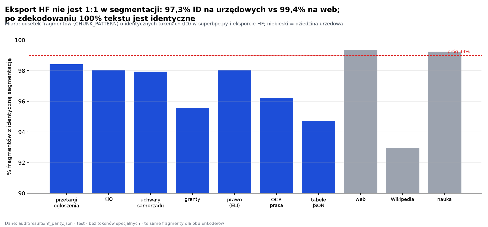

# RAPORT KOŃCOWY — mocne i słabe strony TOKENIZATOREX (TKX-A)

Data: 19.11.2026 · Repo: `adgr3/tokenizatorex` · gałąź `audit/tkx-a-19-11`
· baza `faf06223806809a79f2df0bd64efbd4c57e2d98e` · draft PR #2
· Protokół: `audit/PROTOKOL.md` · Korpus: `audit/data/MANIFEST.json`
· Wszystkie liczby: `audit/results/*.json` (skrypty w `audit/`)
· Niezależne rundy: `audit/independent/codex/` i `audit/independent/grok/`.

## 1. Podsumowanie w 10 zdaniach

1. Na **7 nowych dziedzinach (6 urzędowych 2026 + OCR prasy)** TOKENIZATOREX jest najlepszy na
   6 i praktycznie remisuje na 1; zbiorczo ma **1,6825 tokenu/słowo** wobec
   1,7921 Pollocka (−6,1%), 1,8612 APT3 (−9,6%) i 2,0265 Slayera (−17,0%)
   (tekst przycięty do 20 tys. znaków; patrz zastrzeżenie o pełnych PDF).
2. Na **15 dziedzinach** jest najlepszy na 11; istotnie przegrywa w Wikipedii
   (Pollock, −1,25%), nauce (APT3, −2,95%) i angielskim (GPT-4o 1,68× taniej —
   dziedzina poza celem tokenizera polskiego).
3. **Kalendarz jest zamrożony:** lata 2015–2024 kosztują 1 token, 2025–2026
   już 2; zdanie `w roku RRRR r. zadanie` ma 4 tokeny dla starych lat i 5 dla
   nowych. To najważniejsza słabość dla modelu, który będzie czytał nowe
   ogłoszenia.
4. **Zapisy urzędowe są tanie, ale niestabilne:** kwota 3,87 tokenu (Slayer
   5,23), data słowna 3,76 (5,31), przepis 4,20 (5,78), ale ten sam zapis jest
   dzielony inaczej w 12,8–57,1% kontekstów (Slayer w wielu kategoriach 0%).
5. **Naprawa cyfr nie jest darmowa:** pojedyncze cyfry dodają **+6,7% (dolna)
   do +15,0% (górna)** tokenów na 7 dziedzinach urzędowych; na pełnym
   ogłoszeniu górna granica to **+16,6%**. To świadoma cena za to, by 2024 i
   2027 kosztowały tyle samo.
6. **Odporność jest słaba:** NFD +45,9%, CAPS +106,8%, tytuły +30,6% tokenów;
   względnie więcej niż Slayer1B o 5–9 pkt proc. (NFD, CAPS, tytuły).
7. **Eksport HF nie jest 1:1 w segmentacji:** 97,27% identycznych fragmentów
   (ID) na dziedzinach urzędowych vs 99,36% na web, ale **100% zdekodowanych
   ciągów jest identycznych** — to różnica scalania, nie utrata tekstu; trening
   i ocena muszą używać jednego enkodera.
8. **Słownik jest zdrowy (1,8% martwych tokenów), ale Rényi jest tylko
   opisowy:** APT3 wygrywa obie formy (0,531 i 0,00768 vs TKX 0,527 i 0,00742),
   a literatura (Cognetta i in. 2024) pokazuje, że Rényi nie przewiduje jakości
   modelu. „Najmocniejsza przewaga inżynierska” została wycofana.
9. **Ranking jest odporny (samoocena R3 + 4 nowe źródła Grok), ale pełne PDF
   osłabiają jedną dziedzinę:** na 4 nowych źródłach przewaga nad Pollockiem to
   −6,11%, a na pełnym PDF uchwał śląskich przewaga nad APT3 spada do 0,55%
   (HF 0,82%) — poniżej progu 1%.
10. **Kontekst 150M:** pełne ogłoszenie ma medianę 3984 tokenów, p90 7396,
    w 4096 mieści się 53%, w 2048 tylko 1,7%; pełny akt śląski ma medianę 2403
    i 40% w 2048. To decyzja o oknie i dzieleniu, nie o tokenizerze; jakości
    modelu nie zmierzono.

## 2. Mocne strony

| Mocna strona | Liczba [95% CI] | Plik |
|---|---|---|
| Najlepszy zbiorczo na 7 dziedzinach urzędowych | 1,6825 [1,6412; 1,7279] tok./słowo | `official_aggregate.json` |
| Przewaga nad Slayer1B (oficjalne) | −17,0% tokenów | `official_aggregate.json` |
| Przewaga nad Pollockiem (oficjalne) | −6,1% | `official_aggregate.json` |
| Przewaga nad APT3 (oficjalne) | −9,6% | `official_aggregate.json` |
| 4 nowe źródła (Dolny Śląsk, TED, SAOS, NCN) | −6,11% wobec Pollocka, −7,80% wobec APT3 | `results/new_sources_four.json` |
| KIO: 1. miejsce | 1,403 [1,383; 1,420] | `fertility.json` |
| Kwoty: taniej niż Slayer | 3,87 vs 5,23 tokenu (−26%) | `notations.json` |
| Daty słowne: taniej niż Slayer | 3,76 vs 5,31 (−29%) | `notations.json` |
| Przepisy: taniej niż Slayer | 4,20 vs 5,78 (−27%) | `notations.json` |
| Słownik: mało martwych tokenów | 1,8% (Slayer 8,9%, Pollock 9,4%) | `vocab_usage.json` |
| Szybkość eksportu HF | 575 tys. tok/s, 2,98 MB/s | `speed.json` |
| Stabilność wydajności przy retreningu | −0,12%…+1,96% fertility | `stability.json` |
| Odporność rankingu (samoocena R3) | 0/30 zmian top-1 i top-2 | `RED_TEAM_R3.md` |
| Rzadkie przegrane per dokument (samoocena R3) | Slayer wygrywa 6/606 dok. | `RED_TEAM_R3.md` |

## 3. Słabe strony

| Słabość | Skala [95% CI / zakres] | Przykład | Plik |
|---|---|---|---|
| Kalendarz: nowe lata | 1 → 2 tokeny (2024 → 2026); szablon 4 → 5 | `202│6 r.` vs `202│4·r.` | `notations.json` |
| Niestabilna segmentacja zapisów | 12,8–57,1% kontekstów (Slayer 0–28,6%) | `Dz.U.` → `Dz│.│U.` vs `│Dz.│U.` | `consistency.json` |
| NFD (PDF) | +45,9% [45,0; 46,8] | `ą` → `a` + znak łączący | `robustness.json` |
| CAPS | +106,8% [104,1; 109,5] | `ZAMAWIAJĄCY` | `robustness.json` |
| Title Case | +30,6% [29,6; 31,7] | `Zamawiający` | `robustness.json` |
| HF nie 1:1 w segmentacji | 97,27% vs 99,36% (web); z = −31,0 | tabele JSON −0,52% tokenów | `hf_parity.json` |
| Wikipedia | +1,25% tokenów vs Pollock | — | `fertility.json` |
| Nauka | +2,95% vs APT3 | — | `fertility.json` |
| Angielski | 1,976 vs 1,179 GPT-4o (1,68×) | — | `fertility.json` |
| Morfologia | precision 0,023 vs Slayer 0,082 | `Wyda│je` | `morphology.json` |
| Superwordy od środka słowa | 3,5% słownika, 0,09% użyć | `nk`/`ne przez` | `superwords.json` |
| Częste słowa w superwordach | 2,83% wystąpień | `Ofer│ta -` | `superwords.json` |
| Uchwały tylko z HTML (1. strona) | pełny PDF: przewaga nad APT3 0,55%, HF 0,82% | poniżej progu 1% | `results/full_pdf_uchwaly.json` |
| Kontekst 2048 | pełne ogłoszenie: mediana 3984, 1,7% w 2048 | p90 7396 | `results/context_full.json` |
| Tabele JSON nie są 7. źródłem | ten sam strumień BZP co ogłoszenia | — | `independent/grok/RED_TEAM_GROK_R3.md` |

## 3A. Koszt wariantu „każda cyfra osobno” (szacunek)

Dolna granica: metoda Codex A7 (`sum(max(0, cyfry_w_tokenie − 1))`).
Górna granica: każda cyfra osobno + niecyfrowa reszta jako jeden token (Grok).
Test, dokumenty przycięte do 20 tys. znaków:

| dziedzina | udział cyfr w znakach | dolna [% tokenów] | górna [% tokenów] |
|---|---:|---:|---:|
| przetargi_ogloszenia | 4,06% | +5,63% | +17,10% |
| przetargi_kio | 2,41% | +4,51% | +10,52% |
| samorzad_uchwaly | 7,62% | +12,42% | +25,83% |
| granty_ogloszenia | 5,07% | +9,46% | +16,05% |
| prawo_eli | 3,97% | +6,86% | +15,38% |
| ocr_prasa | 1,93% | +2,12% | +4,62% |
| tabele_json | 7,27% | +7,73% | +19,03% |
| web | 0,84% | +1,95% | +3,45% |
| **7 dziedzin urzędowych** | **4,36%** | **+6,68%** | **+15,04%** |

Na **pełnym ogłoszeniu** (bez cięcia 20k, Grok): mediana 3984 → 4646 tokenów
(+16,6%), w 4096 mieści się 53,3% dziś i 33,3% po rozbiciu cyfr; w 2048 nadal
1,7%. Liczby różnią się, bo Codex/Grok liczą na innym tekście (przycięty vs
pełny) i inną metodą (dolna vs górna); **prawdziwy koszt zmierzy TKX-C po
retreningu**, nie ten szacunek (`results/digits_cost.json`).

## 4. Status hipotez H1–H8 (+H9)

| # | Status | Kluczowa liczba | Plik |
|---|---|---|---|
| H1 | **POTWIERDZONA** | 2015–2024: 1,00 tok.; 2025–2026: 2,00; szablon 4→5 | `notations.json` |
| H2 | **CZĘŚCIOWO** | koszt/cyfrę ~0,6 (stały); CPV 21,7%, NIP 46,4% innych podziałów | `notations.json`, `consistency.json` |
| H3 | **POTWIERDZONA** | `lit.` 42,9%, `Dz.U.` 42,9%, `poz.` 42,9% | `consistency.json` |
| H4 | **POTWIERDZONA** | 19/19 kategorii ≥5% | `consistency.json` |
| H5 | **POTWIERDZONA** | NFD +45,9%, CAPS +106,8%, Title +30,6% | `robustness.json` |
| H6 | **OBALONA** (skala 19,4%) | 3,5% (1,6–13,2%), użycie 0,09% (0,04–0,59%) | `superwords.json` |
| H7 | **CZĘŚCIOWO / NIE** | 88,2% top 1000 ma token; 2,83% rozbitych | `superwords.json` |
| H8 | **POTWIERDZONA** | 97,27% vs 99,36%; z = −31,0; ciągi 100% | `hf_parity.json` |
| H9 | **OBSŁUŻONA** | import HF przed `sys.path.append`; test w CI | `test_audit.py` |

## 5. Długość dokumentów a kontekst modelu 150M

Liczby z niezależnej rundy 3 (Grok), pełny tekst bez cięcia 20k, tokenizer HF:

| dokument | mediana | p90 | w 2048 | w 4096 |
|---|---:|---:|---:|---:|
| ogłoszenie przetargowe (BZP) | **3984** | **7396** | **1,7%** | **53,3%** |
| ogłoszenie po rozbiciu cyfr (górna granica) | 4646 | 8471 | 0,0% | 33,3% |
| KIO (uzasadnienie) | 1666 | 6612 | 60,6% | 77,3% |
| grant NIW | 2336 | 22 593 | 42,4% | 57,6% |
| prawo ELI | 2918 | 35 118 | 42,3% | 60,3% |
| uchwała śląska — pełny PDF | **2403** | **7408** | **40%** | **72,5%** |
| uchwała śląska — HTML (1. strona) | 465 | 589 | 100% | 100% |

Źródła: `audit/results/context_full.json`,
`results/doc_lengths_extra.json`, `results/context_truncated.json`.

**Bez rekomendacji ostatecznej** (to decyzja w planie modelu). Opcje:

* **2048 + dzielenie na fragmenty:** tańsze attention (ok. 4× mniej aktywacji
  niż 4096 przy tej samej liczbie sekwencji), ale typowe ogłoszenie i tak się
  nie mieści; dzielenie gubi więź między kwotą, terminem i podstawą prawną,
  jeśli wpadną do różnych okien.
* **4096:** mieści medianę pełnego ogłoszenia (3984) i 53% dokumentów, ale nie
  p90 (7396); po rozbiciu cyfr mediana rośnie do 4646 i wypada z okna.
  Przy stałym budżecie tokenów na krok w batchu to ok. 2× mniej dokumentów.

## 6. Plan TKX-C (decyzja właściciela z 19.11.2026)

**Baza (must-have, bez eksperymentów):**

1. **Pojedyncze cyfry** — kryterium
   sukcesu: `2024` i `2027` mają **ten sam koszt** na zdaniu
   `w roku RRRR r. zadanie`; wzrost długości jest podany obok, nie ukryty.
2. **NFC w potoku, nie w tokenizerze** — pomiar NFD vs NFC na tym korpusie,
   osobna ścieżka dla wersalików; round-trip tekstu zostaje.
3. **Jeden kanoniczny enkoder** (HF) z testem `decode(encode(x)) == x` na całym
   korpusie urzędowym i **zamrożonymi sekwencjami referencyjnymi**; zakaz
   mieszania referencji i HF w jednym wykresie.

**Potem (dopiero po bazie):**

4. **Warianty słownika 16k / 24k / 32k** oceniane na **małych modelach**
   (BPB i sonda jakościowa), **nie przez fertility**. Przy `d_model` 768
   słownik 32k to 24,6 mln parametrów embeddingu (16,4% modelu 150M), a 16k to
   połowa tego — sam spadek fertility nie rozstrzyga.
5. **Dopiero na końcu:** wielkie litery, filtr boilerplate'u, zakaz superwordów
   od środka słowa, Picky BPE/BoundlessBPE, mieszanka danych.

**Czego nie używać do wyboru:** Rényi (opisowy, APT3 wygrywa), sama fertility
(rozbicie cyfr ją podnosi), „0 różnic ID HF” (dziś nieosiągalne i niepotrzebne;
ważny jest jeden enkoder + round-trip).

## 7. Wykresy

Wszystkie w `audit/figures/` (PNG, tytuł mówi wniosek, podtytuł — miara,
stopka — ustawienia).

## 8. Ograniczenia

* **Fertility ≠ jakość modelu.** Modelu 150M nie trenowano; to zadanie tylko
  mierzy. Rényi i MorphScore też nie są kryterium jakości.
* **Pełne PDF uchwał zmieniają obraz:** HTML dziennika to zwykle pierwsza
  strona; na pełnym PDF przewaga nad APT3 spada do 0,55% (HF 0,82%), poniżej
  progu 1%. APT3 jest przy tym stratny (round-trip 6/1010, +115 302 znaki po
  decode), więc to nie jest „wygrana jakością”.
* **Dokumenty przycięte do 20 tys. znaków** (jak w README); red team sprawdził,
  że top-1 się nie zmienia, ale pełne PDF i tak osłabiają uchwały.
* **Tabele JSON** to ten sam strumień BZP co ogłoszenia (JSON z tych samych
  pól), więc „7 dziedzin” nie jest w pełni niezależne.
* **Szacunek cyfr nie jest retreningiem:** +6,4–16,6% to dolna/górna granica
  na pełnym ogłoszeniu; prawdziwy koszt zmierzy TKX-C.
* **Kontekst 2048/4096** to liczby o tekście, nie o VRAM i czasie kroku;
  pamięć attention rośnie kwadratowo.
* **APT3 jest stratny** (NFKC); jego przewaga częściowo pochodzi z innej treści
  po decode. Round-trip trzymają TOKENIZATOREX, HF, base, Slayer, Pollock,
  Bielik, PLLuM i GPT-4o (1010/1010).
* **ELI 2026 to PDF-y**; pypdf może łamać linie — identycznie dla wszystkich.
* **OCR Polony** ma błędy rozpoznawania — celowo (dziedzina `ocr_prasa`).
* **Stabilność** to jeden retrening na jednym innym shardzie HPLT.
* **Morfologia** liczona na izolowanych formach (oficjalny kod MorphScore nie
  ma kontekstu).
* **NCN/TED** nie są czystymi zbiorami 2024–2026; TED i BZP mogą opisywać ten
  sam próg unijny.
* **Bielik v3** był dostępny przez `hf auth whoami`; nie otwieraliśmy `.env`
  ani tokenów.

## 9. Co jest post hoc

* **H6** — poprawiono kryterium „środka słowa” (wiodąca spacja, leksykon
  frekwencyjny) i logikę statusu po recenzji R2; wynik H6 jest post hoc i nadal
  **obala** skalę 19,4%.
* **H1** — poprawiono regex lat (`2020r.`); zmieniło to tylko liczniki
  (+0,77%), nie średnie.
* **H3/H4** — poprawiono sygnaturę, żeby nie wliczała wiodącej spacji
  z kontekstu; wyniki nadal potwierdzają H3/H4.
* **Rényi** — po rundzie 3 dodano formę Zouhara `H/ln|V|` obok `exp(H)/|V|`
  i wycofano zdanie o „najmocniejszej przewadze inżynierskiej”.
* **Cyfry** — pomiar dodany po rundzie 2 (Codex A7) i uzupełniony górną
  granicą z rundy 3; to szacunek, nie retrening.
* **Parytet HF** — po rundzie 2 dodano porównanie zdekodowanych ciągów obok ID
  (100% vs 97,27%).
* **Bootstrap** — ujednolicony na jeden generator NumPy (`common.bootstrap_*`,
  `fertility.py`) po uwadze rundy 2; przedziały CI mogą się minimalnie różnić
  od wersji sprzed korekty.
* **Szybkość** — pomiar zimny (cache Python czyszczony).
* **Daty grantów** — rok/miesiąc z katalogu uploadu PDF, nie z `lastmod`.

## 10. Czego nie zmierzono i dlaczego

* **Jakości modelu 150M** — brak treningu w tym zadaniu.
* **Prawdziwego kosztu pojedynczych cyfr po retreningu** — to TKX-C; tutaj
  tylko dolna/górna granica.
* **Wariantów słownika 16k/24k/32k na małych modelach (BPB, sonda)** — to TKX-C.
* **Prawdziwego SWZ** — użyto proxy: najdłuższe 25% ogłoszeń o zamówieniu.
* **Wpływu poprawek na model** — to TKX-C; tutaj tylko diagnoza.
* **Wszystkich 20 tokenizerów z README** — zadanie definiuje stały zestaw 9.
* **Długich dokumentów >20 tys. znaków** — przycięte; wpływ sprawdzono
  w niezależnej rundzie 3 (pełne PDF, drop10).

## 11. Rundy 2 i 3 — samoocena i rundy niezależne

**Ważne:** `audit/REVIEW_R2.md` i `audit/RED_TEAM_R3.md` to **samoocena
wykonawcy** (niezależny agent w tej samej sesji). **Nie są to niezależne
rundy 2 i 3.** Niezależne rundy wykonali osobno Codex i Grok; ich liczby mają
pierwszeństwo.

### Runda 2 — Codex (niezależna)

* Gałąź `review/tkx-a-r2-codex` @ `47e9cb2`;
  raport `audit/independent/codex/REVIEW_CODEX_R2.md`,
  wyniki `results_codex.json`, kod `compute_codex.py`.
* Werdykt: **PASS_Z_UWAGAMI**, **12/12 liczb powtórzonych**.
* Uwagi: brak pomiaru cyfr (dodany w TKX-A-FIX), Rényi tylko w formie
  `exp(H)/|V|` (dodano `H/ln|V|`), ranking HF #1/TKX #2 wynika ze scalania,
  a nie utraty danych (potwierdzone: ciągi 100%), bootstrap RNG niespójny
  (ujednolicony), parytet HF przez ID (dodano ciągi).
* Fertility i parytet HF zgodne do 0,0000%; H5 różnice wyjaśnione doborem
  dokumentów; H1 liczniki (+0,77%) wyjaśnione regexem.

### Runda 3 — Grok (niezależna)

* Gałąź `review/tkx-a-r3-grok` @ `686cbce`;
  raport `audit/independent/grok/RED_TEAM_GROK_R3.md`, JSON-y `r3_*.json`.
* Werdykt: **zmienia 2, osłabia 2, nie zmienia 3**.
* **Zmienia:** Rényi (APT3 wygrywa obie formy; wycofano „najmocniejszą
  przewagę”); kryterium sukcesu dla modelu 150M (fertility/Rényi nie mówią, czy
  model przeczyta akt).
* **Osłabia:** pełne PDF uchwał (przewaga nad APT3 0,55%, poniżej progu 1%);
  „tokeny albo bajty” jako osobna oś odporności (to tożsamość, nie test).
* **Nie zmienia:** ranking na 4 nowych źródłach (przewaga nad Pollockiem
  −6,11%), round-trip HF (1010/1010), kontekst 2048 (1,7%), H1.
* Nowe liczby: pełne ogłoszenie mediana 3984, p90 7396, 53% w 4096, 1,7%
  w 2048; pełny akt śląski mediana 2403, 40% w 2048; cyfry +6,4–16,6%.

### Co poprawiono po tych rundach

* Rényi: obie formy + wycofanie zdania o przewadze + nota o Cognetta i in.
* Dodano `audit/digits_cost.py`, `results/digits_cost.json` i sekcję 3A.
* Dodano pełne PDF uchwał i 4 nowe źródła (sekcje 2, 3, 8).
* Dodano sekcję o kontekście 2048/4096 (sekcja 5).
* Status R2/R3: jasno oznaczone jako samoocena; niezależne raporty w
  `audit/independent/`.
* Ujednolicono bootstrap RNG i dodano parytet HF na ciągach.
* Zaktualizowano plan TKX-C (sekcja 6) zgodnie z decyzją właściciela.

## 12. Komunikat

Stan: pomiary i poprawki zakończone, testy przechodzą, raporty zaktualizowane.
Push i aktualizacja draft PR czekają na zgodę właściciela (zasada nr 1).
Ostatnia linia: `STATUS=CZEKA_NA_PUSH`.
