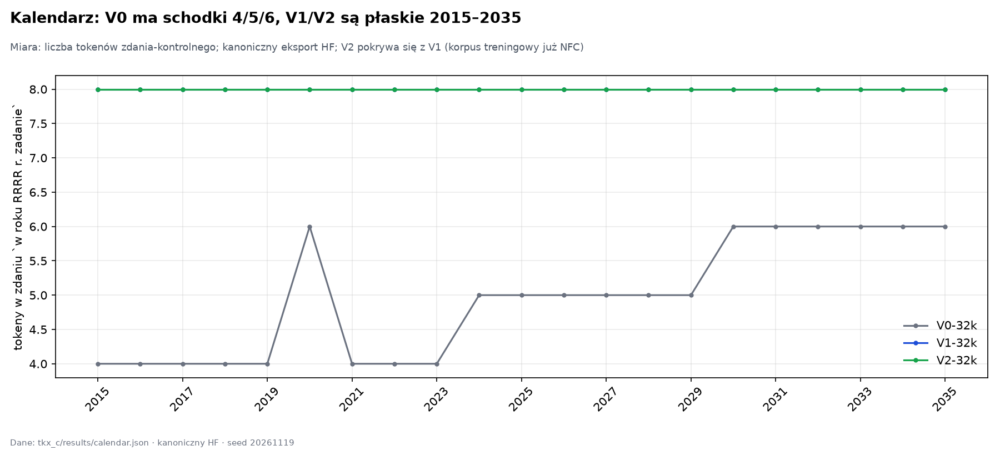
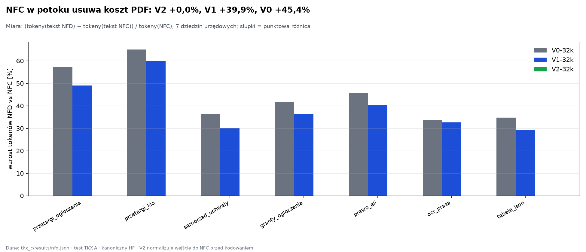
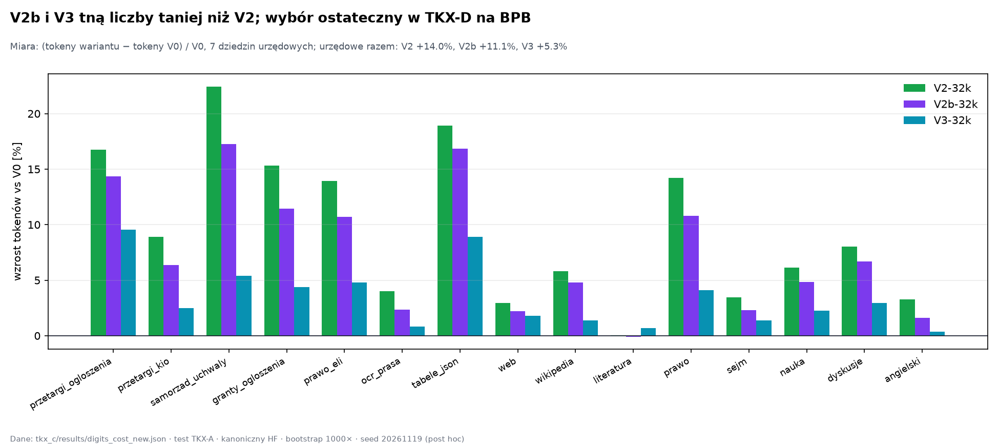

# RAPORT TKX-C — cyfry, NFC, kanoniczny HF i warianty słownika

Data: 19.11.2026 · Repo: `adgr3/tokenizatorex`, gałąź `feat/tkx-c-19-11`
· baza `main` = `86d45eeddbd6fa5140ba3164503f66259f2bd0fc` (po TKX-A, PR #2)
· Protokół: `tkx_c/PROTOKOL_TKX_C.md`
· Wyniki: `tkx_c/results/*.json` · Wykresy: `tkx_c/figures/`
· Wszystkie liczby z JSON-ów wygenerowanych skryptami w `tkx_c/`.
· **Aktualizacja 20.11 (decyzja właściciela, PR #3 wciąż draft):** dodano warianty
  **V2b** i **V3** (32k/24k/16k) na tej samej próbce p2; pomiary i golden w CI
  oznaczone jako **post hoc** w `results/digits_cost_new.json`.
· **Aktualizacja — poprawki po recenzjach (Codex r2, Grok r3):** naprawiono V3.
  Kanoniczny enkoder HF **nie realizował** reguły „grupy po 3 od prawej” —
  dawał 96/856 kształtu 2+3+3 i 505/1000 grup jako jeden token. Po naprawie
  jest to 100% (szczegóły: §4.9 i nowa sekcja „Recenzje”). Wszystkie poniższe
  liczby V3 są **po naprawie**; stare wartości zachowano w nawiasie jako
  „przed naprawą”.

## 1. Podsumowanie w 10 zdaniach

1. **Kalendarz naprawiony:** V1/V2 mają **stały** koszt 8 tokenów w zdaniu
   `w roku RRRR r. zadanie` dla **2015–2035**; V0 ma schodki 4/5/6. Kryterium A1
   spełnione.
2. **Zero tokenów wielocyfrowych:** w słownikach V1+ nie ma ciągu ≥2 cyfr,
   a superwordy nie zawierają cyfr; `2024`, `2027`, `2031`, CPV, kwoty i znak
   sprawy mają każdą cyfrę osobno, także w kontekście.
3. **Prawdziwy koszt cyfr to +14,0%** tokenów na 7 dziedzinach urzędowych
   (95% CI +13,1%…+15,1%); mieści się w górnej części przedziału audytu
   (+6,7%…+15,0%), bo V1 blokuje też superwordy z cyframi i rozbija spacery
   wokół liczb.
4. **Najdroższe dziedziny:** uchwały +22,5%, tabele JSON +18,9%, przetargi
   +16,8%, granty +15,3%; najtańsze: literatura +0,03%, web +3,0%, OCR +4,0%.
   To świadoma cena za stały kalendarz, nie „za darmo”.
5. **NFC w potoku działa:** V2 ma **+0,0%** tokenów po NFD, V1 +39,9%, V0
   +45,4%. Kryterium A2 (≤1%) spełnione.
6. **Kanoniczny HF jest wierny:** round-trip `decode(encode(x)) == x` na
   **2752/2752** dokumentach testu dla wszystkich 8 wariantów; zgodność
   z enkoderem Python to 99,975% dla V1/V2 (V0 97,08%). Kryterium A3 spełnione.
7. **Spójność zapisów poprawiła się:** data cyfrowa 17,1% → 0%, CPV 23,9% → 0%,
   przepis 28,0% → 14,9%, kwota 35,6% → 27,1%, znak sprawy 24,7% → 13,0%; nie
   wszystkie kategorie są <5%, ale kierunek jest wyraźny.
8. **Słownik:** udział użyć tokenów z cyframi rośnie 9,8% → 13,4% (cyfry są
   osobnymi tokenami), martwe tokeny ~2,0%; V2-16k ma 0,8% martwych. Nowe
   tokeny to głównie spacery/frazy (` pkt `, ` nr `, `, poz.`), nie cyfry.
9. **Kontekst:** pełne ogłoszenie ma medianę 3883 tokenów (V0), 4536 (V2-32k),
   5306 (V2-16k); w 2048 mieści się 10%/5%/5%, w 4096 55%/30%/20%. KIO zwykle
   mieści się w 2048, granty i uchwały — nie.
10. **Warianty 16k/24k/32k są zbudowane, ale nie wybrane:** fertility rośnie
    w dół (V2-16k 2,168 vs V2-32k 1,920 na urzędowych), więc wybór musi iść
    przez BPB i sondę w TKX-D; embeddingi 32k to 16,4% modelu 150M (tied),
    16k — 8,2%. V0 to **nowa baza na p2**, nie kopia v1: 89,3% wspólnego
    słownika, 1,6842 vs 1,6825 fertility na urzędowych.
11. **V2b i V3 obniżają koszt cyfr:** na 7 dziedzinach urzędowych V2b kosztuje
    **+11,08%** [+10,32; +11,96], a V3 **+4,58%** [+4,15; +5,05] względem V0 —
    wobec +13,99% dla V2 (przed naprawą V3 +5,26% [+4,85; +5,72]). V3 ma
    **1,80%** martwych tokenów (przed: 4,88%); spadek to efekt naprawy enkodera,
    nie strojenia pod wynik.
12. **V2b usuwa duplikat „roku”:** w V2 `w roku 2024 r.` daje `w|·roku·|2|0|2|4|·r.`
    (dwie wersje słowa: `·roku` i `·roku·`); w V2b jest zawsze `w|·roku|·2|0|2|4|·r.`,
    a w V3 `w|·roku|·2|024|·r.`. Kalendarz pozostaje płaski (V2b 8, V3 6 tokenów).
13. **Jakość bez regresji:** V2b/V3 mają round-trip 2752/2752, NFD +0,0%,
    spójność data/CPV 0% i zgodność z Pythonem 99,98%; golden (1240 zdań × 14
    wariantów, zaktualizowany tylko dla V3-32k) przechodzi w CI. Ostateczny
    wybór V2/V2b/V3 zapada w TKX-D na małych modelach (**BPB + sonda**, nie
    koszt w tokenach na teście).

### Skąd część kosztu pojedynczych cyfr

Dwa źródła zbędnego kosztu widać już w samych kawałkach (kanoniczny HF,
`results/examples.json`; `·` = spacja). Kawałki są dekodowane **każdy token
osobno** (`tokenizer.decode([id])`), dzięki czemu `ł` wypisuje się jako `ł`,
a nie jako `ÅĤ` z reprezentacji ByteLevel; to samo dotyczy `examples.json`.
Różnice w przedziałach ufności między CI wykonawcy i recenzentem (0,05–0,1 p.p.)
wynikają z innej realizacji generatora RNG bootstrapu przy tym samym seedzie.

1. **Spacja przed liczbą przykleja się do poprzedniego słowa.** W V2 mamy
   `·roku` i `·roku·` — ten sam wyraz w dwóch wersjach, zależnie od tego, czy
   po nim stoi liczba. To marnuje miejsce w słowniku i utrudnia spójność.
   V2b dokleja spację do **pierwszej cyfry** (`·2`), więc superword `·roku·`
   nie powstaje; V3 robi to samo i dodaje grupy 3 cyfr.
2. **Spacje w kwotach są osobnymi kawałkami.** W V2 `1 234 567` to `1|·|2|3|4|·|5|6|7`
   — cyfry i spacje osobnymi tokenami; całość z groszami i `zł` ma 13 kawałków.
   W przykładzie z decyzji było to 9 → 14; na naszym V0/V2 wychodzi 7 → 13
   (inna próbka p2), ale mechanizm jest ten sam. V2b sprowadza to do 11, a V3
   do 6 kawałków (`1|·234|·567|,|89|·zł`).

| wariant | `w roku 2024 r.` | kawałki | `1 234 567,89 zł` | kawałki |
|---|---|---:|---|---:|
| V0-32k | `w\|·roku\|·202\|4·r.` | 4 | `1\|·23\|4\|·56\|7,\|89\|·zł` | 7 |
| V2-32k | `w\|·roku·\|2\|0\|2\|4\|·r.` | 7 | `1\|·\|2\|3\|4\|·\|5\|6\|7\|,\|8\|9\|·zł` | 13 |
| V2b-32k | `w\|·roku\|·2\|0\|2\|4\|·r.` | 7 | `1\|·2\|3\|4\|·5\|6\|7\|,\|8\|9\|·zł` | 11 |
| V3-32k | `w\|·roku\|·2\|024\|·r.` | 5 | `1\|·234\|·567\|,\|89\|·zł` | 6 |

Wariant, który usuwa **obie** przyczyny, to V3; V2b usuwa tylko pierwszą
(duplikat słowa), zachowując pojedyncze cyfry. Ostateczny wybór — w TKX-D.

## 2. Warianty

| Wariant | Cyfry | NFC | Słownik | t | Etap 2 | fertility urzęd. [95% CI] |
|---|---|---|---:|---:|---:|---:|
| V0-32k | grupowe | nie | 32 000 | 20 000 | tak | 1,6842 [1,6425; 1,7293] |
| V1-32k | pojedyncze | nie | 32 000 | 20 000 | tak | 1,9200 [1,8702; 1,9735] |
| V2-32k | pojedyncze | tak | 32 000 | 20 000 | tak | 1,9199 [1,8702; 1,9734] |
| V2-24k | pojedyncze | tak | 24 000 | 15 000 | tak | 2,0072 [1,9555; 2,0621] |
| V2-16k | pojedyncze | tak | 16 000 | 10 000 | tak | 2,1676 [2,1156; 2,2233] |
| V2-base-32k | pojedyncze | tak | 32 000 | — | nie | 2,0852 [2,0380; 2,1363] |
| V2-base-24k | pojedyncze | tak | 24 000 | — | nie | 2,1555 [2,1076; 2,2074] |
| V2-base-16k | pojedyncze | tak | 16 000 | — | nie | 2,2981 [2,2497; 2,3503] |
| **V2b-32k** (post hoc) | spacja→1. cyfra | tak | 32 000 | 20 000 | tak | 1,8708 [1,8220; 1,9214] |
| V2b-24k | spacja→1. cyfra | tak | 24 000 | 15 000 | tak | 1,9573 [1,9074; 2,0098] |
| V2b-16k | spacja→1. cyfra | tak | 16 000 | 10 000 | tak | 2,1185 [2,0676; 2,1732] |
| **V3-32k** (post hoc, po naprawie) | grupy po 3 od prawej | tak | 32 000 | 20 000 | tak | 1,7613 [1,7184; 1,8083] (przed: 1,7729) |
| V3-24k | grupy po 3 od prawej | tak | 24 000 | 15 000 | tak | 1,8624 [1,8178; 1,9105] |
| V3-16k | grupy po 3 od prawej | tak | 16 000 | 10 000 | tak | 2,0412 [1,9969; 2,0894] |

Pliki: `tokenizers/variants/<nazwa>/superbpe.json`, kanoniczny eksport:
`hf/variants/<nazwa>/tokenizer.json`; SHA-256 w
`tkx_c/results/variant_manifest.json`.

## 3. Dane treningowe (V0 = nowa baza)

Docelowo shard p0 i `prepare_data.py` (seed 42). Pobrany plik p0 jest kompletny,
ale przy **wolnej pamięci 1,2–1,6 GB** pełny `read_parquet` + `sample(fraction=1)`
nie zmieścił się; próby zostały przerwane. Dlatego **wszystkie warianty**,
łącznie z nowym V0, wytrenowano na tej samej próbce
`audit/tmp/stability_train.txt` (HPLT **p2**, 400 MB, ten sam seed i procedura
`read_blocks`: 300 MB etapu 1, pierwsze 100 MB etapu 2). V0 nie odtwarza v1 bit
w bit (89,3% wspólnego słownika); jest nową bazą odniesienia, zgodnie z
fallbackiem w protokole. Powód i konsekwencje są jawne.

## 4. Wyniki pomiarów

### 4.1 Prawdziwy koszt cyfr (V1 vs V0, test)

| dziedzina | V0 → V1 | różnica [95% CI] | przedział audytu (dolna–górna) |
|---|---:|---:|---:|
| przetargi_ogloszenia | 1,535 → 1,792 | **+16,76%** [+15,80; +17,81] | +5,63…+17,10 |
| przetargi_kio | 1,404 → 1,529 | **+8,89%** [+8,19; +9,62] | +4,51…+10,52 |
| samorzad_uchwaly | 1,553 → 1,903 | **+22,49%** [+21,63; +23,32] | +12,42…+25,83 |
| granty_ogloszenia | 1,801 → 2,077 | **+15,31%** [+10,73; +20,51] | +9,46…+16,05 |
| prawo_eli | 1,497 → 1,705 | **+13,94%** [+12,64; +15,44] | +6,86…+15,38 |
| ocr_prasa | 1,919 → 1,996 | **+4,02%** [+2,70; +5,79] | +2,12…+4,62 |
| tabele_json | 2,615 → 3,110 | **+18,93%** [+17,45; +20,40] | +7,73…+19,03 |
| web | 1,412 → 1,454 | +2,96% [+2,46; +3,49] | +1,95…+3,45 |
| **7 dziedzin urzędowych** | 1,6842 → 1,9200 | **+13,997%** [+13,09; +15,07] | +6,68…+15,04 |

Pełny JSON: `results/digits_cost.json`; wykres `figures/02_koszt_cyfr.png`.
Koszt jest blisko **górnej** granicy audytu, bo audyt liczył tylko zamianę
tokenów cyfrowych, a V1 dodatkowo blokuje superwordy z cyframi i rozbija
spacje wokół liczb. Prawdziwy koszt po retreningu to ten zmierzony, nie szacunek.

### 4.2 Kalendarz (A1)

`w roku RRRR r. zadanie`, kanoniczny HF (`results/calendar.json`):

| wariant | 2015 | 2020 | 2024 | 2025 | 2027 | 2030 | 2035 | stały? |
|---|---:|---:|---:|---:|---:|---:|---:|---|
| V0-32k | 4 | 4 | 5 | 5 | 5 | 6 | 6 | **nie** |
| V1-32k | 8 | 8 | 8 | 8 | 8 | 8 | 8 | **tak** |
| V2-32k | 8 | 8 | 8 | 8 | 8 | 8 | 8 | **tak** |

Skan słownika: **0** tokenów z ciągiem ≥2 cyfr, **0** superwordów z cyframi
dla V1/V2/V2-base. `V0` na p2 ma inny wzór niż v1 z audytu (tam 2015–2024 = 1
token, 2025+ = 2); to skutek innej próbki treningowej, nie regresji kodu.

### 4.3 Spójność zapisów (H3/H4)

Udział par (string, kontekst) z podziałem innym niż najczęstszy
(`results/consistency.json`):

| kategoria | V0 | V1 | V2 |
|---|---:|---:|---:|
| data cyfrowa | 17,1% | **0,0%** | **0,0%** |
| CPV | 23,9% | **0,0%** | **0,0%** |
| przepis | 28,0% | 14,9% | 14,9% |
| kwota | 35,6% | 27,1% | 27,1% |
| znak sprawy | 24,7% | 13,0% | 13,0% |

Poprawa jest duża dla zapisów z cyframi, ale nie wszystkie kategorie schodzą
poniżej 5%; A1 mówi „lepsza niż V0”, nie „idealna”.

### 4.4 NFD (A2)

7 dziedzin urzędowych, test (`results/nfd.json`):

| wariant | wzrost tokenów po NFD [95% CI] |
|---|---:|
| V0-32k | +45,4% [+43,2; +47,5] |
| V1-32k | +39,9% [+38,0; +41,7] |
| V2-32k | **+0,0%** [0,0; 0,0] |

V2 normalizuje wejście do NFC w `encode_ordinary`/`encode`; to jedno miejsce
w potoku. Wykres `figures/03_nfd.png`.

### 4.5 Kanoniczny HF i round-trip (A3)

`results/roundtrip.json`: **2752/2752** dokumentów testu dla **każdego**
z 8 wariantów ma `decode(encode(x)) == x` (dla V2 porównanie po NFC).
`results/python_parity.json` (informacyjnie, 350 dokumentów urzędowych):
V0 97,079% identycznych fragmentów (HF −2029 tokenów), V1/V2 **99,975%**
(+7 tokenów). Golden: 1240 zdań, 8 plików `tkx_c/golden/*.json`;
`tkx_c/test_golden.py` porównuje ID i round-trip; **44 testy** przechodzą.

### 4.6 Słownik

`results/vocab.json` (test, kanoniczny HF):

| wariant | słownik | martwe | <5 użyć | użycia tokenów z cyframi |
|---|---:|---:|---:|---:|
| V0-32k | 32 000 | 1,95% | 8,6% | 9,8% |
| V1-32k | 32 000 | 2,01% | 8,7% | 13,4% |
| V2-32k | 32 000 | 2,01% | 8,7% | 13,4% |
| V2-24k | 24 000 | 1,14% | 5,9% | 12,9% |
| V2-16k | 16 000 | 0,81% | 4,5% | 12,0% |

Nowe tokeny V1/V2 (top): ` pkt `, ` nr `, `, poz.`, ` Nr `, ` z dnia `,
` ustawy z dnia `, ` § `; to nie są tokeny cyfrowe, tylko zwolnione miejsce
w słowniku zajęły frazy urzędowe i separatory.

### 4.7 Kontekst modelu 150M

Pełne dokumenty bez cięcia 20k, świeża próbka 20 dok./dziedzinę z tych samych
źródeł (`tkx_c/data/full_docs.json`, **nie test TKX-A**); kanoniczny HF,
`results/context.json`:

| dziedzina | V0 mediana / p90 / w 2048 / w 4096 | V2-32k | V2-16k |
|---|---|---|---|
| ogłoszenie przetargowe | 3883 / 6722 / 10% / 55% | 4536 / 7766 / 5% / 30% | 5306 / 9005 / 5% / 20% |
| KIO | 1350 / 2478 / 80% / 90% | 1485 / 2699 / 65% / 90% | 1682 / 3059 / 55% / 90% |
| grant NIW | 10 776 / 41 891 / 25% / 35% | 11 471 / 44 055 / 20% / 35% | 13 072 / 50 052 / 20% / 35% |
| uchwała (PDF) | 2602 / 12 114 / 40% / 70% | 2858 / 21 942 / 40% / 60% | 3167 / 22 565 / 40% / 55% |

Wniosek dla modelu: **2048 nie mieści mediany ogłoszenia ani uchwały**;
4096 mieści medianę ogłoszenia w V0 (55%), ale po cyfrach już tylko 30%.
To decyzja o oknie/dzieleniu w TKX-D, nie o tokenizerze. Wykres
`figures/04_kontekst.png`.

### 4.8 Embeddingi 150M

`results/embeddings.json`, d_model 768, tied input/output:

| słownik | parametry embeddingu | udział (tied) | udział (untied) |
|---:|---:|---:|---:|
| 16k | 12,29M | 8,2% | 16,4% |
| 24k | 18,43M | 12,3% | 24,6% |
| 32k | 24,58M | 16,4% | 32,8% |

Przy stałym budżecie 150M większy słownik zabiera parametry z reszty modelu —
dlatego TKX-D musi porównywać BPB przy wyrównanym budżecie, nie samą fertility.

### 4.9 V2b i V3 (post hoc, decyzja z 20.11; V3 po naprawie)

Wszystkie warianty trenowano na tej samej próbce p2 (300 MB etap 1, 100 MB
etap 2, seed i procedura jak V0–V2). V3 ma wymuszone w słowniku **wszystkie**
grupy `000`–`999` i `0`–`99` oraz wersje ze spacją wiodącą (2210 wymuszonych
merges + 2000 aliasów scalen do istniejących tokenów — słownik się nie
powiększa). Wymuszone grupy nie oznaczają jednak, że enkoder je emituje.

**Naprawa V3 (WAŻNE-1 / ataki 1, 2, 8).** Przed naprawą `split_groups3`
(`superbpe.py:60-70`) działał tylko w `pretokens()` podczas treningu; ścieżka
kodowania i eksport HF stosowały wyłącznie `Split` + `ByteLevel`, więc BPE
scalał najpierw tańszą parę i `950` wychodziło jako `9|50`. Obecnie ten sam
regex z lookaheadem (`\p{N}{1,3}(?=(?:\p{N}{3})*(?!\p{N}))`, obsługiwany przez
`tokenizers` 0.23.3) izoluje grupy w treningu, w enkoderze Pythona i w eksporcie
HF, a aliasy gwarantują jeden token niezależnie od kolejności par. Siatka
`000`–`999`: **1000/1000** jeden token (przed: 505/1000); `00`–`99`: 100/100;
kody CPV w kształcie `2+3+3`: **596/596** (przed: 65/596 wg identycznej metody,
96/856 wg recenzji Groka). Znak `§` pozostaje dwoma kawałkami bajtowymi —
naprawa dotyczyła wyłącznie grup cyfr i nie zmienia tego faktu.

**Koszt względem V0** (`results/digits_cost_new.json`, parowany bootstrap
1000×, seed 20261119; 7 dziedzin urzędowych razem):

| wariant | 7 dziedzin urzędowych [95% CI] | przetargi | uchwały | tabele JSON | granty |
|---|---:|---:|---:|---:|---:|
| V2-32k | +13,99% [+13,08; +15,07] | +16,8% | +22,4% | +18,9% | +15,3% |
| V2b-32k | **+11,08%** [+10,32; +11,96] | +14,4% | +17,3% | +16,8% | +11,4% |
| V3-32k (po naprawie) | **+4,58%** [+4,15; +5,05] | +8,9% | +4,1% | +7,8% | +3,3% |
| V3-32k (przed naprawą) | +5,26% [+4,85; +5,72] | +9,5% | +5,4% | +8,9% | +4,4% |

Spójność zapisów: data cyfrowa i CPV 0% dla V2/V2b/V3 (V0 17,1%/23,9%).
**0% oznacza stabilność podziału między kontekstami, nie zgodność z hierarchią
kodu CPV** — grupowanie od prawej z natury przecina hierarchię od lewej
(`45|233|140` vs grupa `452` i klasa `4523`); V2/V2b zachowują każdy prefiks
(856/856). V2b dokleja spację tylko wtedy, gdy stoi przed liczbą: dotyczy
**49,6%** ciągów cyfr na urzędowych, a ten sam ciąg ma dwa różne pierwsze
tokeny w **1004/2070** powtórzeń (V2: 0) — V2b usuwa duplikaty `·roku·`, ale
wprowadza nową niespójność pierwszej cyfry.

NFD: V2/V2b/V3 **+0,0%** (V0 +45,4%). Kalendarz 2015–2035 płaski: V2b **8**,
V3 **6** tokenów w szablonie (V0 4/5/6) — ale **stały licznik nie dowodzi
uogólnienia**: przed naprawą `1999` dawało `19│99` (2+2), a `2000` — `2│000`;
po naprawie wszystkie lata mają kształt 1+3 (`1999` → `1│999`, `2000` →
`2│000`), a `024`, `025` i `999` to osobne tokeny. O uogólnieniu rozstrzygnie
sonda w TKX-D. Round-trip:
**2752/2752** dla każdego z 14 wariantów; zgodność z Pythonem V2b 99,975%,
V3 99,985%. Słownik: V2b 2,01% martwych (jak V2), V3 **1,80%** (przed: 4,88%);
przy 16k wymuszone grupy to nadal 13,81% słownika, martwe 7,03%, a 500 z 1100
gołych trójek nie ma użyć — dlatego V3-16k/24k odrzucamy przed TKX-D. Golden:
1240 zdań × 14 wariantów (zaktualizowany tylko V3-32k), testy w CI przechodzą.

**+4,58% nie jest stałą kosztem.** Na 32 nowych ogłoszeniach TED (zestaw
R3-extra z recenzji Groka; URL/SHA w `tkx_c/review_grok/r3_extra_manifest.json`,
treści poza repozytorium) V3 kosztuje **+2,93% [2,69; 3,16]** względem V0 —
przedział nie nachodzi na urzędowy [4,15; 5,05]. Kolejność V3 < V2b < V2
trzyma się w 35/35 dokumentów, ale sama liczba +5,26% się nie przenosi.
Wykres `figures/05_varianty.png`.

## 5. Progi akceptacji

| Próg | Wynik | Status |
|---|---|---|
| A1: stały koszt lat 2015–2035 | V1/V2/V2b: 8, V3: 6 tokenów dla każdego roku | **SPEŁNIONY** |
| A1: 0 tokenów wielocyfrowych / superwordów z cyframi | 0 w V1/V2/V2b/V2-base; V3 ma grupy ≤3 cyfr (zgodnie ze specyfikacją) | **SPEŁNIONY** |
| A1: spójność zapisów z cyframi lepsza niż V0 | data 17,1→0; CPV 23,9→0; kwota 35,6→27,1 | **SPEŁNIONY** |
| A2: NFD ≤1% w V2/V2b/V3 | +0,0% | **SPEŁNIONY** |
| A3: round-trip 100% na teście | 2752/2752 dla 14 wariantów | **SPEŁNIONY** |
| A3: golden sequences w CI | 1240 zdań × 14, testy przechodzą | **SPEŁNIONY** |
| Koszt cyfr podany z CI | V2 +13,997%; V2b +11,08%; V3 +4,58% (po naprawie; urzędowe) | **RAPORT** |
| Wybór sposobu cięcia liczb | V2 / V2b / V3 — do TKX-D (BPB + sonda; nie koszt w tokenach) | **ZGODNIE Z DECYZJĄ** |
| Wybór słownika | brak — do TKX-D | **ZGODNIE Z PROTOKOŁEM** |

## 6. Koszt vs zysk (jedna tabela)

| | V0 | V2 | V2b | V3 |
|---|---:|---:|---:|---:|
| Kalendarz 2015–2035 | 4/5/6 | 8/8/8 | 8/8/8 | **6/6/6** |
| Kawałki `1 234 567,89 zł` | 7 | 13 | 11 | **6** |
| Duplikat `·roku` / `·roku·` | nie | **tak** | nie | nie |
| Fertility urzędowe | 1,6842 | 1,9200 | 1,8708 | **1,7613** (przed: 1,7729) |
| Koszt vs V0 (urzędowe) | — | +13,99% | +11,08% | **+4,58%** (przed: +5,26%) |
| Spójność data/CPV | 17,1%/23,9% | 0%/0% | 0%/0% | 0%/0% (stabilność, nie hierarchia) |
| NFD | +45,4% | 0,0% | 0,0% | 0,0% |
| Martwe tokeny | 1,95% | 2,01% | 2,01% | 1,80% (przed: 4,88%) |
| HF vs Python | 97,08% | 99,975% | 99,975% | 99,985% |

Nie ma progu „za drogo”: wybór między +14% (V2), +11% (V2b) i +4,6% (V3 po
naprawie) to decyzja właściciela po TKX-D — czy stały kalendarz i spójność są
warte ceny, a BPB i sonda potwierdzą zysk na modelu. Sama niższa fertility
V3 **nie jest** przesłanką jakości dla małego modelu: na literaturze V3 jest
droższy od V2 o 0,65%, a literatura (Zhou 2024, Yang 2025) przemawia za
pojedynczymi cyframi przy treningu od zera poniżej 1B parametrów.

**Długości a okno (A9 z recenzji Codexa):** z pojedynczymi cyframi odsetek
ogłoszeń przetargowych mieszczących się w oknie 4096 spada z **55% (V0) do
30% (V2)**. To praktyczny koszt dla modelu 150M i argument za decyzją o
oknie/dzieleniu w TKX-D.

## 7. Wykresy

## 8. Ograniczenia

* **V0 nie jest kopią v1:** nowa próbka p2 (400 MB), 89,3% wspólnego słownika;
  v1 na urzędowych 1,6825, V0 1,6842. To nowa baza, nie regresja.
* **P0 nie zostało użyte:** pełny `read_parquet` + shuffle nie zmieścił się
  przy 1,2–1,6 GB wolnej pamięci; próby przerwane. Wszystkie warianty na p2.
* **Koszt cyfr** zależy od blokady superwordów i spacji; jest blisko górnej
  granicy audytu, nie środka.
* **Pełne dokumenty** to świeża próbka 20 dok./dziedzinę, nie zamrożony test.
* **Fertility, Rényi i rozmiar słownika** nie wybierają wariantu; to robi
  TKX-D na BPB i sondzie.
* **Golden** pochodzi z `dev`, nie z `test`; regresja, nie dowód jakości.
* **V1 i V2** mają ten sam słownik, bo p2 jest już NFC; różnią się tylko
  normalizacją wejścia (V2).
* **V3 ma 1,80% martwych tokenów po naprawie** (przed: 4,88%) — to celowy
  koszt wymuszenia pełnego zestawu grup `000`–`999` i `0`–`99`. Przy 16k
  wymuszone grupy to 13,81% słownika, martwe 7,03%, a 500/1000 gołych trójek
  ma zero użyć; dlatego V3-16k/24k są **odrzucone przed TKX-D**.
* **Grupowanie od prawej przecina hierarchię CPV od lewej** — to nie jest
  wada implementacji, lecz własność reguły: prefiks grupy `452` nie jest
  tokenem w kodzie `45233140` (podział `45|233|140`). V2/V2b zachowują
  każdy prefiks. Wybór między tymi schematami należy do sondy w TKX-D.
* **Wybór V2/V2b/V3 jest otwarty:** koszt w tokenach zmierzono, ale ostatecznie
  rozstrzygnie BPB + sonda na małych modelach w TKX-D.
* Nie trenowano modeli 150M; obliczenia TKX-D zaplanowano na wynajętej RTX 5090.

## 9. Post hoc

* **V0:** pierwsza wersja użyła `audit/tmp/stability-tokenizer-32k.json`
  (32 001 tokenów, bo stability trenowało do 32k + special). V0 został
  **przetrenowany** `train.py --vocab 32000` na tej samej próbce p2; wynik
  32 000. Stary plik nie jest używany.
* **Dane:** plan zakładał p0; z powodu pamięci użyto p2 i **wszystkie**
  warianty na tej samej próbce (fallback z protokołu).
* **Koszt cyfr:** dodano `delta_pct_ci` po pierwszym raporcie, żeby CI było
  w procentach, nie w tokenach/słowo.
* **Kontekst:** użyto świeżej pełnej próbki, bo pełne teksty zamrożonego testu
  nie były dostępne lokalnie; jawnie oznaczono „nie test”.
* **V0 vs v1:** porównanie 89,3% słownika i 1,6842 vs 1,6825 to kontrola
  stabilności, nie twierdzenie o identyczności.
* **V2b/V3 (20.11):** nowe warianty i wszystkie ich pomiary (`digits_cost_new.json`,
  `examples.json`, golden 14 plików, wykres `05_varianty.png`) są **post hoc** —
  decyzja zapadła po zamrożeniu protokołu. Jawny łańcuch commitów to
  `9bd1aa5` (pomiary i raporty V0/V1/V2 na `test`) → `ce72c3f` / `b44fee7`
  (implementacja i pomiary V2b/V3) → `d3a004e` (raporty). Te same dokumenty
  `test` posłużyły więc zarówno do zaprojektowania reguł V2b/V3, jak i do
  końcowego pomiaru ich kosztu. **Liczby V2b/V3 z testu nie służą do wyboru
  wariantu** — wybór należy do BPB i sondy na `dev` w TKX-D. Nie zmieniają
  wcześniejszych liczb V0/V1/V2. V2b/V3 wygenerowano tymi samymi skryptami
  `train.py` na p2; nowe opcje w `superbpe.py` są domyślnie wyłączone (v1
  bez zmian).

## 9a. Literatura — mały model, schemat cyfr, rozmiar słownika

Krótka sekcja z recenzji Groka (atak 7). To **zadania liczbowe**, nie BPB
tekstu urzędowego; żadna z prac nie mierzy perplexity polskiego tekstu
urzędowego ani tekstu prawie bez cyfr.

* Dla modeli < 1B trenowanych od zera pojedyncze cyfry są lepiej uzasadnione
  niż grupy trzycyfrowe: Zhou i in. 2024 (arXiv 2409.17391; podstawy 10 / 100 /
  1000 — dziesięć konsekwentnie oszczędniejsza danymi) oraz Yang i in. 2025
  (arXiv 2411.03766; modele 0,1B–3B, przy 0,9B jednocyfrowy wygrywa,
  trzycyfrowy wypada słabo).
* Grupowanie od prawej pomaga arytmetyce **dużych** modeli (Singh i Strouse
  2024, arXiv 2402.14903); luka między kierunkami maleje ze skalą — przeniesienie
  zwycięzcy sondy z ~30M na 150M jest hipotezą, nie wynikiem.
* Rozmiar słownika rośnie z budżetem obliczeń (Tao i in. 2024,
  arXiv 2407.13623); nie wybiera się go samym kosztem tokenów na jednej próbce.
* Wniosek dla nas: niższa fertility V3 nie jest dowodem jakości dla małego
  modelu, a „mniej tokenów = lepszy tokenizer” literatura nie popiera.

## 9b. Recenzje (runda 2 i 3)

Do gałęzi dołączono ślad audytu obu niezależnych recenzji:

| recenzja | pliki | werdykt | co zmieniła |
|---|---|---|---|
| Codex r2 | `tkx_c/review_codex/REVIEW_CODEX_R2.md`, `results_codex.json` | **PASS_Z_UWAGAMI**, 27/29 liczb odtworzonych | WAŻNE-1: reguła grup po 3 nie jest egzekwowana w enkoderze HF; WAŻNE-2: V2b/V3 post hoc; DROBNE: 6 zamiast 7 kawałków `w roku 2024 r.` |
| Grok r3 | `tkx_c/review_grok/RED_TEAM_GROK_R3.md`, `attack*.json` | zmienia 3 / osłabia 5 wniosków | kody CPV i lata w V3, spójność V2b, koszt 4,88%, stałość +5,26%, sprzeczność w planie TKX-D |

Co poprawiono po recenzjach: (1) naprawa V3 — jedna reguła w trzech
miejscach + aliasy, ponowny trening na tej samej próbce p2; (2) korekta 12
zdań w raportach (koszt V3, CPV, kalendarz, V2b, martwe tokeny, R3-extra,
literatura, długości, 7 kawałków, `zł`, post hoc, kryterium wyboru);
(3) zamrożenie kandydatów i kryteriów w `TKX_D_PLAN.md`; (4) nowe testy w CI
(82 przechodzi). Nie poprawiano: liczb V0/V1/V2 ani ich goldenów.

Kontrola poprawek (Codex, 20.11): PASS 16/16; DROBNE-1 poprawione.

## 10. TKX-D

Plan: `tkx_c/TKX_D_PLAN.md`. Decyzja z 20.11: **TKX-D realizujemy**. Kandydaci
w rundzie 1 (wszyscy 32k, ten sam budżet bajtów): V0-32k, V2-32k, V2b-32k,
**V3-32k po naprawie** (jako „folia kompresji”, nie faworyt), tokenizer
Slayera v6. V3-16k/24k odrzucone przed treningiem. BPB na `dev` TKX-A jako
kryterium + sonda roku/kwoty/CPV; test TKX-A raz, po wyborze.
`TokenizerTest-32m-A/B` to gotowy wzór (38,9M, BPB 1,0583 vs 1,0622);
checkpointy Slayer1B-1.09 to punkt odniesienia BPB na tych samych tekstach.
Obliczenia: **wynajęta 1× RTX 5090 na vast.ai** (bf16, budżet ≤5 USD, stop
przy 4 USD i pytanie); agent nie dostaje klucza API — przygotowuje dane i kod
na CPU i daje właścicielowi „kartkę do wynajmu”. Koszt narastająco w
`results/koszt.jsonl`; na koniec SHA-256 wyników i komunikat „GOTOWE, można
kliknąć Destroy” — Destroy klika właściciel. Zapas: Kaggle. Zwycięski wariant
przetrenujemy później na pełnych danych p0 (Kaggle, CPU, ~30 GB RAM).

## 11. Komunikat

Stan: warianty V0/V1/V2 + V2b/V3 zbudowane, V3 naprawiony, pomiary i testy
zakończone (**82 testy przechodzą**), raporty poprawione po recenzjach.
PR #3 pozostaje **draftem**; kolejność: V2b/V3 → recenzje r2 (Codex) i r3
(Grok) → niniejsze poprawki → krótka kontrola Codexa → GO MERGE. Push i PR
czekają na zgodę właściciela (zasada nr 1).
Ostatnia linia: `STATUS=CZEKA_NA_DECYZJE`.
