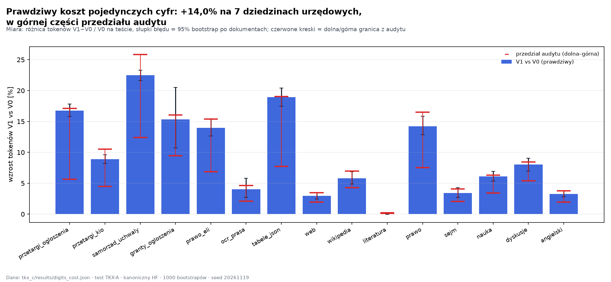
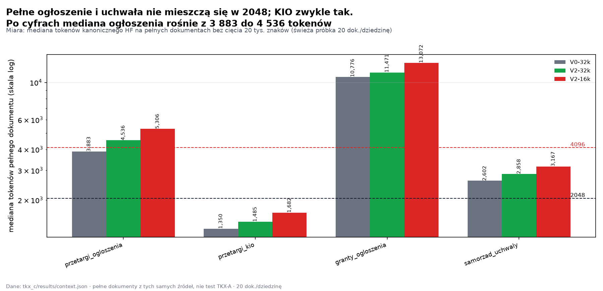

# RAPORT TKX-C — cyfry, NFC, kanoniczny HF i warianty słownika

Data: 19.11.2026 · Repo: `adgr3/tokenizatorex`, gałąź `feat/tkx-c-19-11`
· baza `main` = `86d45eeddbd6fa5140ba3164503f66259f2bd0fc` (po TKX-A, PR #2)
· Protokół: `tkx_c/PROTOKOL_TKX_C.md`
· Wyniki: `tkx_c/results/*.json` · Wykresy: `tkx_c/figures/`
· Wszystkie liczby z JSON-ów wygenerowanych skryptami w `tkx_c/`.

## 1. Podsumowanie w 10 zdaniach

1. **Kalendarz naprawiony:** V1/V2 mają **stały** koszt 8 tokenów w zdaniu
   `w roku RRRR r. zadanie` dla **2015–2035**; V0 ma schodki 4/5/6. Kryterium A1
   spełnione.
2. **Zero tokenów wielocyfrowych:** w słownikach V1+ nie ma ciągu ≥2 cyfr,
   a superwordy nie zawierają cyfr; `2024`, `2027`, `2031`, CPV, kwoty i znak
   sprawy mają każdą cyfrę osobno, także w kontekście.
3. **Prawdziwy koszt cyfr to +14,0%** tokenów na 7 dziedzinach urzędowych
   (95% CI +13,1%…+15,1%); mieści się w górnej części przedziału audytu
   (+6,7%…+15,0%), bo V1 blokuje też superwordy z cyframi i rozbija spacery
   wokół liczb.
4. **Najdroższe dziedziny:** uchwały +22,5%, tabele JSON +18,9%, przetargi
   +16,8%, granty +15,3%; najtańsze: literatura +0,03%, web +3,0%, OCR +4,0%.
   To świadoma cena za stały kalendarz, nie „za darmo”.
5. **NFC w potoku działa:** V2 ma **+0,0%** tokenów po NFD, V1 +39,9%, V0
   +45,4%. Kryterium A2 (≤1%) spełnione.
6. **Kanoniczny HF jest wierny:** round-trip `decode(encode(x)) == x` na
   **2752/2752** dokumentach testu dla wszystkich 8 wariantów; zgodność
   z enkoderem Python to 99,975% dla V1/V2 (V0 97,08%). Kryterium A3 spełnione.
7. **Spójność zapisów poprawiła się:** data cyfrowa 17,1% → 0%, CPV 23,9% → 0%,
   przepis 28,0% → 14,9%, kwota 35,6% → 27,1%, znak sprawy 24,7% → 13,0%; nie
   wszystkie kategorie są <5%, ale kierunek jest wyraźny.
8. **Słownik:** udział użyć tokenów z cyframi rośnie 9,8% → 13,4% (cyfry są
   osobnymi tokenami), martwe tokeny ~2,0%; V2-16k ma 0,8% martwych. Nowe
   tokeny to głównie spacery/frazy (` pkt `, ` nr `, `, poz.`), nie cyfry.
9. **Kontekst:** pełne ogłoszenie ma medianę 3883 tokenów (V0), 4536 (V2-32k),
   5306 (V2-16k); w 2048 mieści się 10%/5%/5%, w 4096 55%/30%/20%. KIO zwykle
   mieści się w 2048, granty i uchwały — nie.
10. **Warianty 16k/24k/32k są zbudowane, ale nie wybrane:** fertility rośnie
    w dół (V2-16k 2,168 vs V2-32k 1,920 na urzędowych), więc wybór musi iść
    przez BPB i sondę w TKX-D; embeddingi 32k to 16,4% modelu 150M (tied),
    16k — 8,2%. V0 to **nowa baza na p2**, nie kopia v1: 89,3% wspólnego
    słownika, 1,6842 vs 1,6825 fertility na urzędowych.

## 2. Warianty

| Wariant | Cyfry | NFC | Słownik | t | Etap 2 | fertility urzęd. [95% CI] |
|---|---|---|---:|---:|---:|---:|
| V0-32k | grupowe | nie | 32 000 | 20 000 | tak | 1,6842 [1,6425; 1,7293] |
| V1-32k | pojedyncze | nie | 32 000 | 20 000 | tak | 1,9200 [1,8702; 1,9735] |
| V2-32k | pojedyncze | tak | 32 000 | 20 000 | tak | 1,9199 [1,8702; 1,9734] |
| V2-24k | pojedyncze | tak | 24 000 | 15 000 | tak | 2,0072 [1,9555; 2,0621] |
| V2-16k | pojedyncze | tak | 16 000 | 10 000 | tak | 2,1676 [2,1156; 2,2233] |
| V2-base-32k | pojedyncze | tak | 32 000 | — | nie | 2,0852 [2,0380; 2,1363] |
| V2-base-24k | pojedyncze | tak | 24 000 | — | nie | 2,1555 [2,1076; 2,2074] |
| V2-base-16k | pojedyncze | tak | 16 000 | — | nie | 2,2981 [2,2497; 2,3503] |

Pliki: `tokenizers/variants/<nazwa>/superbpe.json`, kanoniczny eksport:
`hf/variants/<nazwa>/tokenizer.json`; SHA-256 w
`tkx_c/results/variant_manifest.json`.

## 3. Dane treningowe (V0 = nowa baza)

Docelowo shard p0 i `prepare_data.py` (seed 42). Pobrany plik p0 jest kompletny,
ale przy **wolnej pamięci 1,2–1,6 GB** pełny `read_parquet` + `sample(fraction=1)`
nie zmieścił się; próby zostały przerwane. Dlatego **wszystkie warianty**,
łącznie z nowym V0, wytrenowano na tej samej próbce
`audit/tmp/stability_train.txt` (HPLT **p2**, 400 MB, ten sam seed i procedura
`read_blocks`: 300 MB etapu 1, pierwsze 100 MB etapu 2). V0 nie odtwarza v1 bit
w bit (89,3% wspólnego słownika); jest nową bazą odniesienia, zgodnie z
fallbackiem w protokole. Powód i konsekwencje są jawne.

## 4. Wyniki pomiarów

### 4.1 Prawdziwy koszt cyfr (V1 vs V0, test)

| dziedzina | V0 → V1 | różnica [95% CI] | przedział audytu (dolna–górna) |
|---|---:|---:|---:|
| przetargi_ogloszenia | 1,535 → 1,792 | **+16,76%** [+15,80; +17,81] | +5,63…+17,10 |
| przetargi_kio | 1,404 → 1,529 | **+8,89%** [+8,19; +9,62] | +4,51…+10,52 |
| samorzad_uchwaly | 1,553 → 1,903 | **+22,49%** [+21,63; +23,32] | +12,42…+25,83 |
| granty_ogloszenia | 1,801 → 2,077 | **+15,31%** [+10,73; +20,51] | +9,46…+16,05 |
| prawo_eli | 1,497 → 1,705 | **+13,94%** [+12,64; +15,44] | +6,86…+15,38 |
| ocr_prasa | 1,919 → 1,996 | **+4,02%** [+2,70; +5,79] | +2,12…+4,62 |
| tabele_json | 2,615 → 3,110 | **+18,93%** [+17,45; +20,40] | +7,73…+19,03 |
| web | 1,412 → 1,454 | +2,96% [+2,46; +3,49] | +1,95…+3,45 |
| **7 dziedzin urzędowych** | 1,6842 → 1,9200 | **+13,997%** [+13,09; +15,07] | +6,68…+15,04 |

Pełny JSON: `results/digits_cost.json`; wykres `figures/02_koszt_cyfr.png`.
Koszt jest blisko **górnej** granicy audytu, bo audyt liczył tylko zamianę
tokenów cyfrowych, a V1 dodatkowo blokuje superwordy z cyframi i rozbija
spacje wokół liczb. Prawdziwy koszt po retreningu to ten zmierzony, nie szacunek.

### 4.2 Kalendarz (A1)

`w roku RRRR r. zadanie`, kanoniczny HF (`results/calendar.json`):

| wariant | 2015 | 2020 | 2024 | 2025 | 2027 | 2030 | 2035 | stały? |
|---|---:|---:|---:|---:|---:|---:|---:|---|
| V0-32k | 4 | 4 | 5 | 5 | 5 | 6 | 6 | **nie** |
| V1-32k | 8 | 8 | 8 | 8 | 8 | 8 | 8 | **tak** |
| V2-32k | 8 | 8 | 8 | 8 | 8 | 8 | 8 | **tak** |

Skan słownika: **0** tokenów z ciągiem ≥2 cyfr, **0** superwordów z cyframi
dla V1/V2/V2-base. `V0` na p2 ma inny wzór niż v1 z audytu (tam 2015–2024 = 1
token, 2025+ = 2); to skutek innej próbki treningowej, nie regresji kodu.

### 4.3 Spójność zapisów (H3/H4)

Udział par (string, kontekst) z podziałem innym niż najczęstszy
(`results/consistency.json`):

| kategoria | V0 | V1 | V2 |
|---|---:|---:|---:|
| data cyfrowa | 17,1% | **0,0%** | **0,0%** |
| CPV | 23,9% | **0,0%** | **0,0%** |
| przepis | 28,0% | 14,9% | 14,9% |
| kwota | 35,6% | 27,1% | 27,1% |
| znak sprawy | 24,7% | 13,0% | 13,0% |

Poprawa jest duża dla zapisów z cyframi, ale nie wszystkie kategorie schodzą
poniżej 5%; A1 mówi „lepsza niż V0”, nie „idealna”.

### 4.4 NFD (A2)

7 dziedzin urzędowych, test (`results/nfd.json`):

| wariant | wzrost tokenów po NFD [95% CI] |
|---|---:|
| V0-32k | +45,4% [+43,2; +47,5] |
| V1-32k | +39,9% [+38,0; +41,7] |
| V2-32k | **+0,0%** [0,0; 0,0] |

V2 normalizuje wejście do NFC w `encode_ordinary`/`encode`; to jedno miejsce
w potoku. Wykres `figures/03_nfd.png`.

### 4.5 Kanoniczny HF i round-trip (A3)

`results/roundtrip.json`: **2752/2752** dokumentów testu dla **każdego**
z 8 wariantów ma `decode(encode(x)) == x` (dla V2 porównanie po NFC).
`results/python_parity.json` (informacyjnie, 350 dokumentów urzędowych):
V0 97,079% identycznych fragmentów (HF −2029 tokenów), V1/V2 **99,975%**
(+7 tokenów). Golden: 1240 zdań, 8 plików `tkx_c/golden/*.json`;
`tkx_c/test_golden.py` porównuje ID i round-trip; **44 testy** przechodzą.

### 4.6 Słownik

`results/vocab.json` (test, kanoniczny HF):

| wariant | słownik | martwe | <5 użyć | użycia tokenów z cyframi |
|---|---:|---:|---:|---:|
| V0-32k | 32 000 | 1,95% | 8,6% | 9,8% |
| V1-32k | 32 000 | 2,01% | 8,7% | 13,4% |
| V2-32k | 32 000 | 2,01% | 8,7% | 13,4% |
| V2-24k | 24 000 | 1,14% | 5,9% | 12,9% |
| V2-16k | 16 000 | 0,81% | 4,5% | 12,0% |

Nowe tokeny V1/V2 (top): ` pkt `, ` nr `, `, poz.`, ` Nr `, ` z dnia `,
` ustawy z dnia `, ` § `; to nie są tokeny cyfrowe, tylko zwolnione miejsce
w słowniku zajęły frazy urzędowe i separatory.

### 4.7 Kontekst modelu 150M

Pełne dokumenty bez cięcia 20k, świeża próbka 20 dok./dziedzinę z tych samych
źródeł (`tkx_c/data/full_docs.json`, **nie test TKX-A**); kanoniczny HF,
`results/context.json`:

| dziedzina | V0 mediana / p90 / w 2048 / w 4096 | V2-32k | V2-16k |
|---|---|---|---|
| ogłoszenie przetargowe | 3883 / 6722 / 10% / 55% | 4536 / 7766 / 5% / 30% | 5306 / 9005 / 5% / 20% |
| KIO | 1350 / 2478 / 80% / 90% | 1485 / 2699 / 65% / 90% | 1682 / 3059 / 55% / 90% |
| grant NIW | 10 776 / 41 891 / 25% / 35% | 11 471 / 44 055 / 20% / 35% | 13 072 / 50 052 / 20% / 35% |
| uchwała (PDF) | 2602 / 12 114 / 40% / 70% | 2858 / 21 942 / 40% / 60% | 3167 / 22 565 / 40% / 55% |

Wniosek dla modelu: **2048 nie mieści mediany ogłoszenia ani uchwały**;
4096 mieści medianę ogłoszenia w V0 (55%), ale po cyfrach już tylko 30%.
To decyzja o oknie/dzieleniu w TKX-D, nie o tokenizerze. Wykres
`figures/04_kontekst.png`.

### 4.8 Embeddingi 150M

`results/embeddings.json`, d_model 768, tied input/output:

| słownik | parametry embeddingu | udział (tied) | udział (untied) |
|---:|---:|---:|---:|
| 16k | 12,29M | 8,2% | 16,4% |
| 24k | 18,43M | 12,3% | 24,6% |
| 32k | 24,58M | 16,4% | 32,8% |

Przy stałym budżecie 150M większy słownik zabiera parametry z reszty modelu —
dlatego TKX-D musi porównywać BPB przy wyrównanym budżecie, nie samą fertility.

## 5. Progi akceptacji

| Próg | Wynik | Status |
|---|---|---|
| A1: stały koszt lat 2015–2035 | V1/V2: 8 tokenów dla każdego roku | **SPEŁNIONY** |
| A1: 0 tokenów wielocyfrowych / superwordów z cyframi | 0 w V1/V2/V2-base | **SPEŁNIONY** |
| A1: spójność zapisów z cyframi lepsza niż V0 | data 17,1→0; CPV 23,9→0; kwota 35,6→27,1 | **SPEŁNIONY** |
| A2: NFD ≤1% w V2 | +0,0% | **SPEŁNIONY** |
| A3: round-trip 100% na teście | 2752/2752 dla 8 wariantów | **SPEŁNIONY** |
| A3: golden sequences w CI | 1240 zdań × 8, testy przechodzą | **SPEŁNIONY** |
| Koszt cyfr podany z CI | +13,997% [+13,09; +15,07] urzędowe | **RAPORT** |
| Wybór słownika | brak — do TKX-D | **ZGODNIE Z PROTOKOŁEM** |

## 6. Koszt vs zysk (jedna tabela)

| | V0 | V1/V2 | zmiana |
|---|---:|---:|---:|
| Kalendarz 2015–2035 | 4/5/6 | **8/8/8** | stały, ale +2…+4 tokeny |
| Tokeny z cyframi w słowniku | 10 | 10 (pojedyncze) | 0 wielocyfrowych |
| Fertility urzędowe | 1,6842 | 1,9200 | **+14,0%** |
| Spójność data/CPV | 17,1%/23,9% | **0%/0%** | duży zysk |
| NFD (V2) | +45,4% | **+0,0%** | duży zysk |
| HF vs Python | 97,08% | **99,975%** | prawie 1:1 |
| Kontekst: ogłoszenie w 4096 | 55% | 30% | **−25 pkt proc.** |

Nie ma progu „za drogo”: +14% to decyzja właściciela, czy stały kalendarz
i spójność są warte tej ceny. W TKX-D zobaczymy, czy BPB to potwierdza.

## 7. Wykresy

## 8. Ograniczenia

* **V0 nie jest kopią v1:** nowa próbka p2 (400 MB), 89,3% wspólnego słownika;
  v1 na urzędowych 1,6825, V0 1,6842. To nowa baza, nie regresja.
* **P0 nie zostało użyte:** pełny `read_parquet` + shuffle nie zmieścił się
  przy 1,2–1,6 GB wolnej pamięci; próby przerwane. Wszystkie warianty na p2.
* **Koszt cyfr** zależy od blokady superwordów i spacji; jest blisko górnej
  granicy audytu, nie środka.
* **Pełne dokumenty** to świeża próbka 20 dok./dziedzinę, nie zamrożony test.
* **Fertility, Rényi i rozmiar słownika** nie wybierają wariantu; to robi
  TKX-D na BPB i sondzie.
* **Golden** pochodzi z `dev`, nie z `test`; regresja, nie dowód jakości.
* **V1 i V2** mają ten sam słownik, bo p2 jest już NFC; różnią się tylko
  normalizacją wejścia (V2).
* Nie trenowano modeli 150M; nie ma GPU.

## 9. Post hoc

* **V0:** pierwsza wersja użyła `audit/tmp/stability-tokenizer-32k.json`
  (32 001 tokenów, bo stability trenowało do 32k + special). V0 został
  **przetrenowany** `train.py --vocab 32000` na tej samej próbce p2; wynik
  32 000. Stary plik nie jest używany.
* **Dane:** plan zakładał p0; z powodu pamięci użyto p2 i **wszystkie**
  warianty na tej samej próbce (fallback z protokołu).
* **Koszt cyfr:** dodano `delta_pct_ci` po pierwszym raporcie, żeby CI było
  w procentach, nie w tokenach/słowo.
* **Kontekst:** użyto świeżej pełnej próbki, bo pełne teksty zamrożonego testu
  nie były dostępne lokalnie; jawnie oznaczono „nie test”.
* **V0 vs v1:** porównanie 89,3% słownika i 1,6842 vs 1,6825 to kontrola
  stabilności, nie twierdzenie o identyczności.

## 10. TKX-D

Plan: `tkx_c/TKX_D_PLAN.md`. Kandydaci: V0-32k, V2-16k, V2-24k, V2-32k,
Slayer1B; BPB na tych samych bajtach, sonda dat/kwot/CPV/skrótów, budżet
z embeddingami. `TokenizerTest-32m-A/B` to gotowy wzór (38,9M, BPB
1,0583 vs 1,0622); checkpointy Slayer1B 1.09 ładowane przez
`inspect_checkpoint.py` (fp32, bez bf16). Bez trenowania modeli w TKX-C.

## 11. Komunikat

Stan: warianty zbudowane, pomiary i testy zakończone, raporty gotowe.
Push i draft PR czekają na zgodę właściciela (zasada nr 1).
Ostatnia linia: `STATUS=CZEKA_NA_DECYZJE`.
